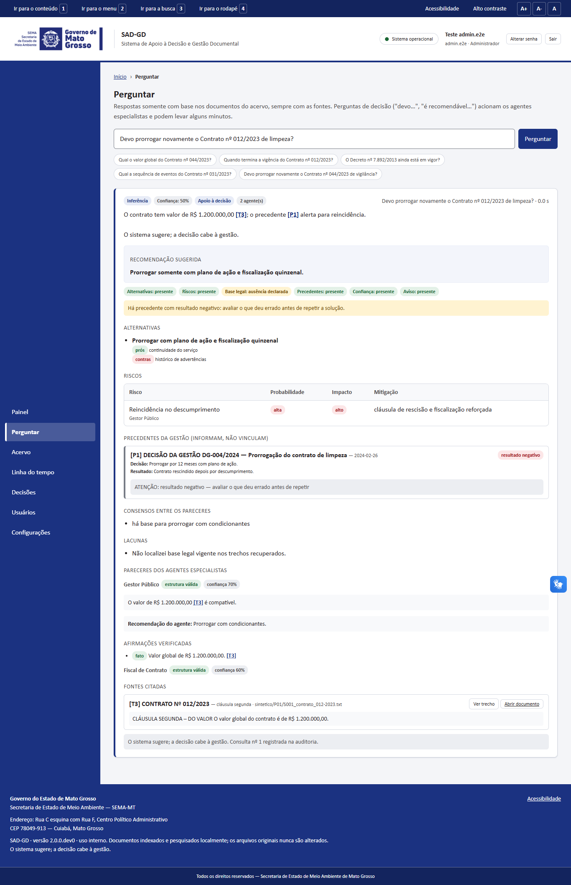

# SAD-GD — Sistema de Apoio à Tomada de Decisão e Gestão Documental

Sistema de IA para o setor público que **lê, analisa e responde perguntas** sobre contratos, leis, decretos,
instruções normativas, pareceres e processos — **sempre citando o trecho literal da fonte** — e **apoia a alta
gestão** com recomendações de agentes especialistas (Procurador, Advogado, Controlador, Fiscal de Contrato,
Gestor, Analista), com alternativas, riscos, base legal, precedentes e nível de confiança.

> **O sistema sugere, a gestão decide.** Sem evidência documental, a resposta é
> *"Não localizei essa informação nos documentos disponibilizados."*

Atividade avaliativa do Curso de Engenharia de IA · Versão 2.0.0.dev0 · Execução **100% local e gratuita**
(nuvem opcional só para o corpus acadêmico).

---

## Resultados (conjunto de teste do golden set)

| Métrica | Meta | Resultado |
|---|---|---|
| Recall@5 | ≥ 0,90 | **0,965** (sistema legado: 0,431) |
| Faithfulness | ≥ 0,90 | **0,964** (adjudicada) |
| Alucinação numérica / por frase | ≤ 5% | **0%** / 5,4% |
| Classificação de tipo documental | ≥ 0,85 | **1,00** |
| Roteamento de perguntas | ≥ 0,90 | **0,935** |
| Precedentes Recall@3 | ≥ 0,80 | **1,00** |
| Recomendação F2 com os 6 elementos | 100% | **100%** |
| Latência F2 p95 | ≤ 120 s | 387 s local · **100 s** com Gemini (corpus acadêmico) |
| Custo por consulta | gratuito | **R$ 0** |

Detalhes, protocolo e evolução por versão: [`docs/AVALIACAO.md`](docs/AVALIACAO.md) ·
relatório completo: [`docs/RELATORIO_TECNICO.md`](docs/RELATORIO_TECNICO.md).

---

## Funcionalidades

| | |
|---|---|
| **F1 — Perguntas com fonte** | Busca híbrida (BM25 + bge-m3) com reranker; resposta com `[T<id>]` clicável que abre o trecho e o documento original na página certa; verificador remove frases e números sem fonte |
| **F2 — Apoio à decisão** | Roteador aciona só os especialistas relevantes; pareceres em JSON validados; relator com consensos, divergências, alternativas (prós/contras), riscos (probabilidade × impacto), base legal vigente pela hierarquia normativa e precedentes |
| **Linha do tempo** | Grafo documental com 8 relações (continuação, aditivo, alteração, revogação, substituição, ruptura, contradição, retomada) e evidência clicável |
| **Vigência** | Norma revogada não fundamenta decisão atual (aparece só como histórico) |
| **Memória de decisões** | Decisões anteriores e seus resultados usados como precedentes (informam, não vinculam) |
| **Acervo** | Upload com indexação no servidor, OCR de digitalizados, filtros por tipo/origem/situação |
| **Segurança e LGPD** | Perfis (Administrador, Gestor, Consulta), servidor em `127.0.0.1`, auditoria com hash da pergunta, dados reais nunca saem da máquina, pseudonimização antes de qualquer envio remoto |



---

## Arquitetura

```text
Navegador ──► FastAPI (127.0.0.1:8000) ──► Orquestrador LangGraph
                    │                       ├─ Roteador (regras) ─► F1 simples | F1 complexa | F2
                    │                       ├─ Recuperação: FTS5/BM25 + bge-m3 → RRF → vigência → bge-reranker-v2-m3
                    │                       ├─ Especialistas em paralelo ─► Verificador ─► Relator ─► RF-20
                    │                       └─ LLM: Ollama local (Qwen 2.5 7B) | Gemini free tier (só corpus acadêmico)
                    └─► SQLite único: documentos, trechos, FTS5, sqlite-vec, grafo, normas, decisões, auditoria, cache
```

**Stack (toda gratuita):** Python 3.15 · FastAPI · LangGraph · SQLite (FTS5 + sqlite-vec) · Ollama portátil
(Qwen 2.5 7B) · BAAI/bge-m3 · BAAI/bge-reranker-v2-m3 · PyMuPDF · Tesseract 5 · HTML/CSS/JS · pytest · Playwright
(Edge) · GitHub Actions.

Clean Architecture (`app/domain` → `app/application` → `app/infrastructure`), C4 em
[`docs/arquitetura/C4.md`](docs/arquitetura/C4.md), 13 ADRs em [`docs/adr/`](docs/adr/), agentes em
[`docs/agentes/`](docs/agentes/README.md).

---

## Como rodar

Requisitos: Windows 10/11, Python ≥ 3.13, ≈ 15 GB de disco; GPU NVIDIA de 6 GB recomendada.

```powershell
git clone https://github.com/danilodxavier/SGD
cd SGD
.\instalar.bat                                                  # .venv, dependências, Ollama, Tesseract, banco, diagnóstico
.\.venv\Scripts\python.exe scripts\sadgd\preparar_bge_m3.py     # modelo de embeddings (uma vez)
.\.venv\Scripts\python.exe scripts\sadgd\indexar.py --max-minutos 7.5   # repetir até concluir
.\.venv\Scripts\python.exe scripts\sadgd\construir_grafo.py
.\.venv\Scripts\python.exe scripts\sadgd\gerar_memoria_decisoes.py
.\.venv\Scripts\python.exe scripts\sadgd\importar_decisoes.py
.\start.bat                                                     # http://127.0.0.1:8000
```

No primeiro acesso, a tela pede a criação do administrador. Perguntas de exemplo aparecem na tela **Perguntar**.

- Uso das telas: [`docs/MANUAL_DO_USUARIO.md`](docs/MANUAL_DO_USUARIO.md)
- Instalação, configuração, backup, provedor em nuvem e solução de problemas: [`docs/MANUAL_TECNICO.md`](docs/MANUAL_TECNICO.md)

---

## Como avaliar

```powershell
.\.venv\Scripts\python.exe -m pytest -q                         # 316 testes + 4 E2E no Edge
.\.venv\Scripts\python.exe scripts\sadgd\avaliar.py recuperacao  # P@k, R@k, MRR, nDCG
.\.venv\Scripts\python.exe scripts\sadgd\avaliar_respostas.py --sistema v2 --modelo sadgd-qwen2.5-7b --conjunto teste --verificador --max-minutos 8.5
.\.venv\Scripts\python.exe scripts\sadgd\avaliar_f2.py --rotulo meu_teste --max-minutos 4   # repetir até [OK]; --resumo
```

Golden set: 177 perguntas (validação 53 / teste 124) + 50 de precedentes, em `avaliacao/golden_set/`. O conjunto
de teste nunca é usado para ajustes. Lista completa de avaliações no manual técnico (§11).

---

## Corpus

| Origem | Documentos | Uso |
|---|---|---|
| `corpus/publico` | 69 atos oficiais (Constituição, leis, leis complementares, decretos) com URL, data de coleta e SHA-256 | Avaliação e demonstração |
| `corpus/sintetico` | 117 documentos de 27 processos fictícios, com gabarito de relações | Avaliação e demonstração |
| `corpus/enviados`, `DOCUMENTOS/` | Documentos reais | Somente local, fora do Git, nunca enviados à nuvem |

Manifesto: [`corpus/MANIFESTO.csv`](corpus/MANIFESTO.csv) · decisão: [`ADR-002`](docs/adr/ADR-002-corpus-academico.md).

---

## Documentação

| Documento | Conteúdo |
|---|---|
| [`docs/RELATORIO_TECNICO.md`](docs/RELATORIO_TECNICO.md) | Relatório técnico (problema, arquitetura, avaliação, limitações) |
| [`docs/RELATORIO_ATIVIDADES_E_FERRAMENTAS.md`](docs/RELATORIO_ATIVIDADES_E_FERRAMENTAS.md) | Atividades e ferramentas por fase |
| [`docs/STATUS.md`](docs/STATUS.md) · [`docs/CONTINUIDADE.md`](docs/CONTINUIDADE.md) | Checkpoint e retomada |
| [`docs/fases/`](docs/fases/) | Fases 0–11: planejamento, evidências e aprovação |
| [`docs/projeto/`](docs/projeto/) | Termo de abertura, requisitos, EAP, cronograma, riscos, backlog, rastreabilidade |
| [`docs/AVALIACAO.md`](docs/AVALIACAO.md) | Métricas por versão |
| [`docs/MODELOS_IA.md`](docs/MODELOS_IA.md) · [`docs/METODOLOGIAS.md`](docs/METODOLOGIAS.md) · [`docs/HABILIDADES.md`](docs/HABILIDADES.md) | Rastreabilidade de IA, métodos e aprendizado |
| [`docs/video/ROTEIRO.md`](docs/video/ROTEIRO.md) | Vídeo de apresentação |
| [`docs/legado/`](docs/legado/) | Documentação da v1 |
| [`CHANGELOG.md`](CHANGELOG.md) · [`CLAUDE.md`](CLAUDE.md) | Mudanças · regras do projeto e decisões vigentes |

---

## Metodologia

12 fases (sprints 0–11) com aprovação a cada entrega · PMBOK 7 · Scrum/Kanban · CRISP-DM/LLMOps · Clean
Architecture e SOLID · TDD nos componentes críticos · C4 · ADRs · Conventional Commits · GitHub Flow · CI com
gitleaks, ruff, testes, cobertura e regressão de qualidade. Desenvolvimento assistido pelo Claude Code
(`claude-opus-5-5`), registrado em [`docs/MODELOS_IA.md`](docs/MODELOS_IA.md).

## Limitações

Latência da F2 no hardware local (p95 387 s; cache e provedor em nuvem para o corpus acadêmico mitigam);
alucinação por frase 5,4% (meta 5%, adjudicação pendente de confirmação humana); relações com F1 1,00 só no corpus
sintético (sobreajuste declarado; 10/10 relações oficiais no público). Detalhes no relatório técnico, §10.
