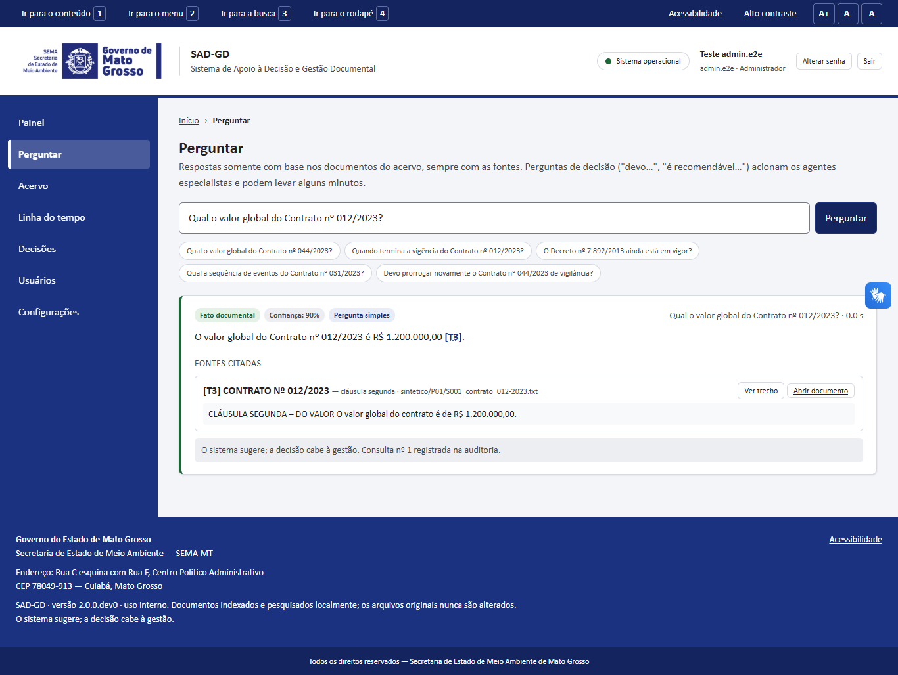
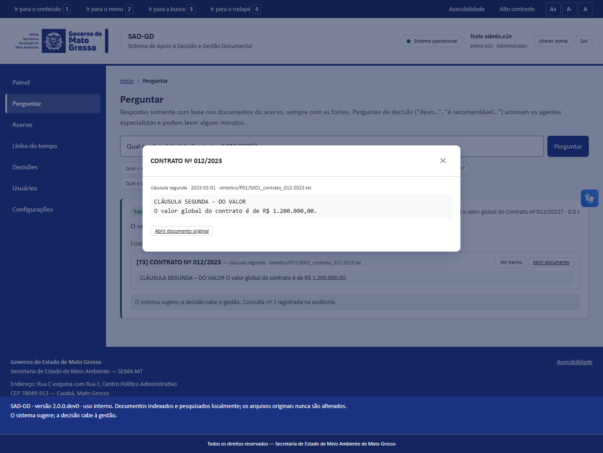
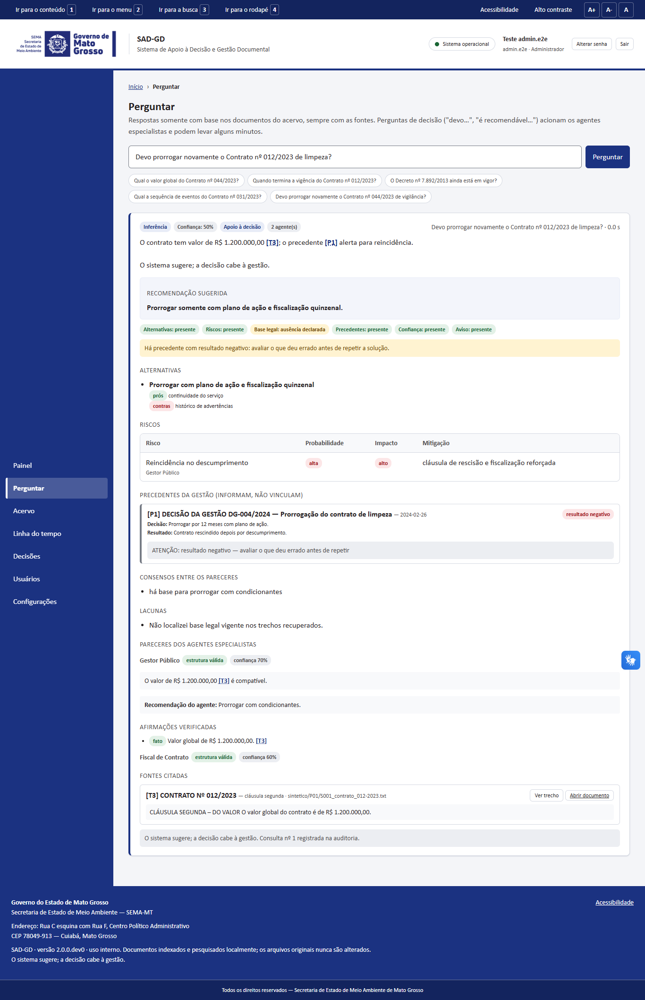
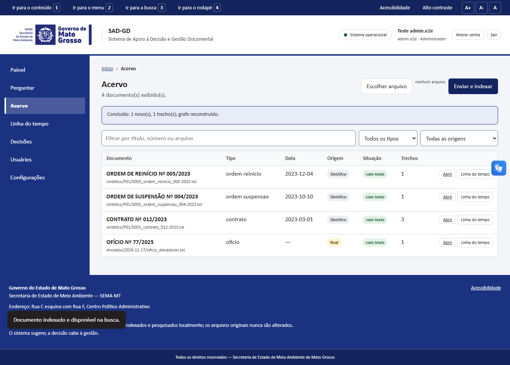
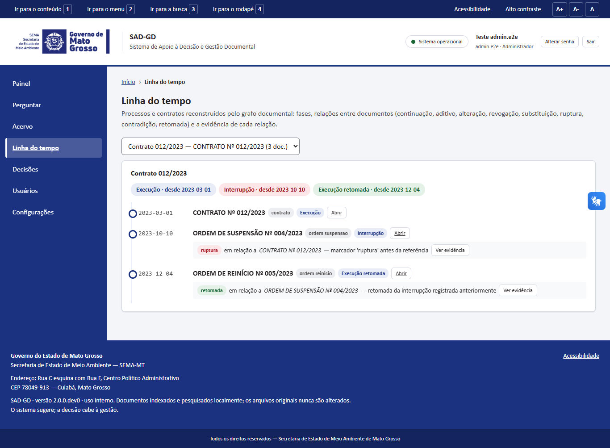

# Manual do Usuário — SAD-GD

| | |
|---|---|
| **Sistema** | SAD-GD — Sistema de Apoio à Tomada de Decisão e Gestão Documental |
| **Versão documentada** | 2.0.0.dev0 |
| **Data** | 17/11/2026 |
| **Público** | Gestores, servidores e equipes de apoio, inclusive quem nunca usou o sistema |

> Este manual explica **como usar** o sistema. Instalação, configuração, backup e solução de problemas técnicos estão
> no [Manual Técnico](MANUAL_TECNICO.md). O manual da versão anterior (v1) está em `docs/legado/`.

## Sumário

1. [O que o SAD-GD faz (e o que não faz)](#1-o-que-o-sad-gd-faz-e-o-que-não-faz)
2. [Acesso](#2-acesso)
3. [Visão geral da tela](#3-visão-geral-da-tela)
4. [Perguntar — respostas com fontes](#4-perguntar--respostas-com-fontes)
5. [Perguntar — apoio à decisão](#5-perguntar--apoio-à-decisão)
6. [Acervo — consultar e enviar documentos](#6-acervo--consultar-e-enviar-documentos)
7. [Linha do tempo](#7-linha-do-tempo)
8. [Memória de decisões](#8-memória-de-decisões)
9. [Painel](#9-painel)
10. [Administração (somente Administrador)](#10-administração-somente-administrador)
11. [Boas práticas para perguntar](#11-boas-práticas-para-perguntar)
12. [Privacidade e LGPD](#12-privacidade-e-lgpd)
13. [Perguntas frequentes](#13-perguntas-frequentes)
14. [Glossário](#14-glossário)

---

## 1. O que o SAD-GD faz (e o que não faz)

O SAD-GD lê os documentos do acervo (contratos, aditivos, leis, decretos, instruções normativas, pareceres,
processos e decisões anteriores) e:

- **responde perguntas** citando o trecho exato de onde tirou cada informação (documento, página, dispositivo);
- **mostra a linha do tempo** de um contrato ou processo: aditivos, suspensões, retomadas, revogações, contradições;
- **apoia decisões**: reúne a análise de agentes especialistas (Procurador, Advogado, Controlador, Fiscal de
  Contrato, Gestor, Analista e outros) e sugere uma recomendação com alternativas, riscos, base legal, precedentes
  e nível de confiança.

O que ele **não** faz:

- **Não decide.** Toda recomendação é uma sugestão fundamentada. **O sistema sugere, a gestão decide.**
- **Não inventa.** Se a informação não estiver nos documentos, a resposta é:
  *"Não localizei essa informação nos documentos disponibilizados."*
- **Não altera documentos.** Os arquivos originais nunca são movidos, renomeados, alterados ou excluídos.
- **Não usa norma revogada para fundamentar decisão atual** — ela aparece apenas como histórico.

---

## 2. Acesso

### 2.1 Abrir o sistema

O sistema roda no próprio computador. Depois que a equipe de TI o iniciar (`start.bat`), abra o navegador em:

**http://127.0.0.1:8000**

### 2.2 Primeiro acesso do sistema (uma única vez)

Se nenhum usuário existir, a tela pede a criação do **primeiro administrador**: informe usuário (ex.: `maria.silva`),
nome completo e senha.

### 2.3 Entrar

Informe **usuário** e **senha** e clique em **Entrar**.

- Usuário: 3 a 50 caracteres, letras minúsculas sem acento, números, ponto, hífen ou sublinhado.
- Senha: no mínimo 8 caracteres, com letras **e** números, diferente do usuário.
- Após **5 tentativas erradas seguidas**, a conta fica bloqueada por **15 minutos** (o administrador pode desbloquear antes).
- Usuário criado pelo administrador recebe uma **senha temporária**: no primeiro acesso o sistema exige a troca.

**Esqueci a senha:** peça a um administrador para redefini-la. **Alterar a senha:** botão **Alterar senha** no
topo da tela. **Sair:** botão **Sair**.

### 2.4 Perfis

| Ação | Consulta | Gestor | Administrador |
|---|:---:|:---:|:---:|
| Perguntar (respostas e apoio à decisão) | ✅ | ✅ | ✅ |
| Ver acervo, linha do tempo, decisões e painel | ✅ | ✅ | ✅ |
| Enviar documentos ao acervo | — | ✅ | ✅ |
| Registrar decisões e resultados | — | ✅ | ✅ |
| Reindexar o acervo inteiro, usuários, configurações | — | — | ✅ |

---

## 3. Visão geral da tela

- **Topo:** nome e perfil do usuário, **Alterar senha**, **Sair** e a barra de acessibilidade (**Alto contraste**,
  **A+**, **A-**, **A**).
- **Menu à esquerda:** **Painel**, **Perguntar**, **Acervo**, **Linha do tempo**, **Decisões** e, para
  administradores, **Usuários** e **Configurações**.
- **Área central:** a tela escolhida.

---

## 4. Perguntar — respostas com fontes

1. Clique em **Perguntar** no menu.
2. Digite a pergunta (ou clique em um dos exemplos abaixo da caixa) e clique em **Perguntar**.
3. Aguarde "Analisando os documentos…". Perguntas de consulta levam em geral 10 a 30 segundos.

### 4.1 Como ler a resposta

| Elemento | Significado |
|---|---|
| **Fato documental** (verde) | A resposta está escrita nos documentos |
| **Inferência** (azul) | Conclusão tirada de trechos citados, não escrita literalmente |
| **Conflito** (vermelho) | Documentos dizem coisas diferentes — os dois lados são mostrados |
| **Informação ausente** (amarelo) | Os documentos não trazem a informação |
| **Confiança** | Grau de segurança da resposta (0–100%) |
| **Pergunta simples / complexa / Apoio à decisão** | Como o sistema classificou a pergunta |
| **[T123]** no texto | Atalho para o trecho citado — clique para ler |
| **Fontes citadas** | Lista dos trechos usados, com **Ver trecho** e **Abrir documento** (abre o original na página certa) |
| Selo **revogado** | O trecho vem de norma revogada (vale só como histórico) |
| **Verificador de fontes** | Aviso de que frases sem fonte foram retiradas da resposta |
| **Consulta nº …** | Número do registro na auditoria |

**Sempre confira o trecho citado** antes de usar a informação em um ato oficial.

---

## 5. Perguntar — apoio à decisão

Perguntas de decisão ("Devo…", "É recomendável…", "Qual a melhor alternativa…") acionam os **agentes
especialistas**. Só os perfis relevantes para o tema são chamados (em geral 2 ou 3).

> **Tempo:** no computador local, uma pergunta de decisão pode levar **3 a 6 minutos**. A tela mostra o tempo
> decorrido. Perguntas repetidas são respondidas na hora (o sistema reaproveita a resposta quando a pergunta, os
> documentos e os identificadores são os mesmos).

### 5.1 Como ler a recomendação

| Seção | O que mostra |
|---|---|
| **Recomendação sugerida** | Síntese em 1–2 frases |
| Selos dos **6 elementos** | Alternativas, Riscos, Base legal, Precedentes, Confiança e Aviso — verde = presente; amarelo = ausência declarada (o sistema avisa que não encontrou); vermelho = ausente |
| Alertas | Avisos importantes (ex.: precedente com resultado negativo, norma revogada) |
| **Alternativas** | Cada caminho possível com **prós** e **contras** |
| **Riscos** | Tabela com probabilidade, impacto, mitigação e o agente que apontou |
| **Base legal vigente** | Normas aplicáveis, ordenadas pela hierarquia (Constituição > Lei > Decreto > IN > Orientação) |
| **Normas revogadas consideradas apenas como histórico** | Normas que já não fundamentam a decisão |
| **Precedentes da gestão** | Decisões anteriores parecidas, com o resultado e a lição — **informam, não vinculam** |
| **Consensos / Divergências** | Onde os especialistas concordam e onde discordam (com a posição de cada um) |
| **Lacunas** | O que faltou nos documentos para uma análise completa |
| **Pareceres dos agentes especialistas** | Clique em cada agente para ver o parecer completo, as afirmações verificadas e a fundamentação |

**Use a recomendação como insumo**, não como decisão. Se a confiança for baixa ou houver lacunas, complemente a
instrução do processo antes de decidir.

---

## 6. Acervo — consultar e enviar documentos

### 6.1 Consultar

- Filtre por **título, número ou arquivo**, por **tipo documental** e por **origem**:
  **Público** (atos oficiais), **Sintético** (base acadêmica de demonstração) ou **Real** (enviado ao sistema).
- A coluna **Situação** mostra se a norma está vigente ou revogada.
- Use o atalho da linha para abrir o documento ou ver sua linha do tempo.

### 6.2 Enviar um documento (Gestor e Administrador)

1. Clique em **Escolher arquivo** e selecione o documento.
   Formatos aceitos: PDF, DOCX, DOC, ODT, RTF, TXT, MD, HTML, XLSX, XLS, ODS, CSV, PPTX, PPT, PNG, JPG, TIF (até 25 MB).
2. Clique em **Enviar e indexar**.
3. Acompanhe a barra de indexação até **Concluído**. O documento passa a aparecer no acervo, nas buscas e nas
   linhas do tempo.

Observações:
- Um arquivo com o mesmo nome **não substitui** o existente; o sistema grava uma cópia com sufixo.
- PDFs digitalizados passam por OCR automaticamente (pode demorar mais).
- Documentos enviados são tratados como **reais**: nunca são enviados a serviços externos.

---

## 7. Linha do tempo

1. Clique em **Linha do tempo** e selecione um processo ou contrato.
2. A tela mostra as **fases** (cores diferentes), os **eventos** em ordem cronológica e as **relações** entre os
   documentos:

| Relação | Exemplo |
|---|---|
| Continuação | Novo ato do mesmo processo, sem mudar o anterior |
| Aditivo | Termo aditivo de prazo ou valor |
| Alteração | Norma que altera artigo de outra |
| Revogação | Norma que revoga outra (no todo ou em parte) |
| Substituição | Contrato ou norma que substitui outro |
| Ruptura / interrupção | Suspensão, rescisão, paralisação |
| Retomada | Ordem de reinício após suspensão |
| Contradição | Documentos com informações incompatíveis (ex.: valores diferentes) |

3. Clique na **evidência** de uma relação para ver o trecho que a comprova. Inconsistências aparecem destacadas.

---

## 8. Memória de decisões

A tela **Decisões** guarda decisões anteriores da gestão e seus resultados. Elas aparecem como **precedentes** nas
perguntas de decisão.

- **Buscar precedentes:** descreva uma situação e clique em **Buscar precedentes**.
- **Registrar decisão** (Gestor/Administrador): informe título, código (opcional), data, contexto, decisão,
  fundamentos e, se já houver, o resultado observado e a avaliação (**Pendente**, **Positivo**, **Neutro**,
  **Negativo**).
- **Registrar resultado:** quando o efeito da decisão for conhecido, use o botão da linha para registrar o resultado
  e a avaliação. Isso torna os próximos precedentes mais úteis.

Escreva o contexto e os fundamentos de forma objetiva, citando números de contrato, processo e normas: é assim
que o sistema encontra o precedente certo.

---

## 9. Painel

Mostra a situação do acervo: documentos por origem, trechos e vetores indexados, processos, relações,
contradições, normas revogadas, decisões registradas, consultas por tipo (com tempo médio) e a última indexação.
Administradores podem clicar em **Atualizar índice** para incluir documentos novos da pasta do acervo.

---

## 10. Administração (somente Administrador)

### 10.1 Usuários

- **Novo usuário:** usuário, nome, perfil (**Consulta**, **Gestor**, **Administrador**) e senha temporária.
  Informe a senha temporária **pessoalmente** à pessoa; ela será obrigada a trocá-la no primeiro acesso.
- Na lista: alterar perfil, ativar/desativar, **Redefinir senha** e desbloquear contas.

### 10.2 Configurações

| Seção | Uso |
|---|---|
| Diretório documental | Pasta raiz do acervo (**Selecionar pasta…**, **Salvar**) |
| Indexação | **Iniciar indexação** (só o que mudou) ou **Reindexar tudo** |
| Verificação do sistema | **Verificar sistema**: confere Python, bibliotecas, banco (SQLite/FTS5), pasta do acervo, permissões, espaço em disco e OCR |
| OCR | Mecanismo de OCR, **Testar OCR** e **Reprocessar digitalizados** |
| Modelos de IA (locais) | Modelos em uso |
| Sistema / Logs | Versão e **Carregar últimos registros** |

---

## 11. Boas práticas para perguntar

| Faça | Evite |
|---|---|
| Cite o identificador: "Contrato nº 044/2023", "Lei nº 14.133/2021, art. 107" | "aquele contrato da vigilância" |
| Uma pergunta por vez | Várias perguntas na mesma frase |
| Para decisão, diga a ação: "Devo prorrogar o Contrato nº 044/2023?" | "O que acha do contrato?" |
| Pergunte pela sequência: "Qual a sequência de eventos do Contrato nº 031/2023?" | Supor que o último documento é o vigente |
| Confira o trecho citado antes de usar a resposta em um ato | Copiar a resposta sem conferir |

Exemplos prontos estão abaixo da caixa de pergunta.

---

## 12. Privacidade e LGPD

- O sistema funciona **no computador local** e, por padrão, só aceita conexões dele mesmo (`127.0.0.1`).
- **Documentos reais nunca são enviados a serviços externos.** Um provedor de IA em nuvem só pode ser usado,
  se a TI o habilitar, para a base acadêmica (documentos públicos e sintéticos), com nomes e CPF mascarados.
- Cada consulta fica registrada na **auditoria** (número da consulta, rota, agentes, fontes), sem guardar o texto
  da pergunta em claro.
- Não envie ao acervo documentos que você não tenha autorização para tratar.

---

## 13. Perguntas frequentes

**A resposta diz "Não localizei essa informação…". O sistema está com defeito?**
Não. Significa que nenhum documento do acervo sustenta a resposta. Verifique se o documento foi enviado e indexado
(tela **Acervo**) e se o número do contrato/norma está correto.

**A resposta trouxe "Conflito". O que faço?**
Leia os dois trechos citados. Em geral há um aditivo ou retificação; a linha do tempo do processo mostra qual
documento é posterior.

**A pergunta de decisão está demorando.**
É esperado no computador local (3 a 6 minutos). Não feche a página; o tempo decorrido é mostrado na tela.

**Um agente aparece com "parecer inválido — ignorado pelo relator".**
O parecer não passou na verificação de formato ou de fontes e não foi usado na recomendação. Os demais continuam
válidos.

**Enviei um documento e ele não aparece.**
Aguarde a barra chegar a **Concluído**. Arquivos digitalizados demoram mais (OCR). Se persistir, procure o
administrador.

**Posso usar a recomendação diretamente no despacho?**
Não sem análise. A recomendação é um apoio; a responsabilidade pela decisão é da gestão.

---

## 14. Glossário

| Termo | Significado |
|---|---|
| Acervo | Conjunto de documentos que o sistema consulta |
| Agente especialista | Módulo de IA com um papel (Procurador, Fiscal etc.) que emite parecer sobre a pergunta |
| Base legal vigente | Normas em vigor que fundamentam a recomendação |
| Confiança | Grau de segurança atribuído à resposta (0–100%) |
| Indexação | Leitura dos documentos e preparo para busca |
| OCR | Reconhecimento de texto em documentos digitalizados (imagens) |
| Precedente | Decisão anterior da gestão em situação parecida |
| Relator | Agente que consolida os pareceres em uma recomendação |
| Trecho | Parte de um documento (artigo, cláusula, parágrafo) usada como fonte |
| Verificador de fontes | Etapa que retira da resposta qualquer frase ou número sem fonte |
