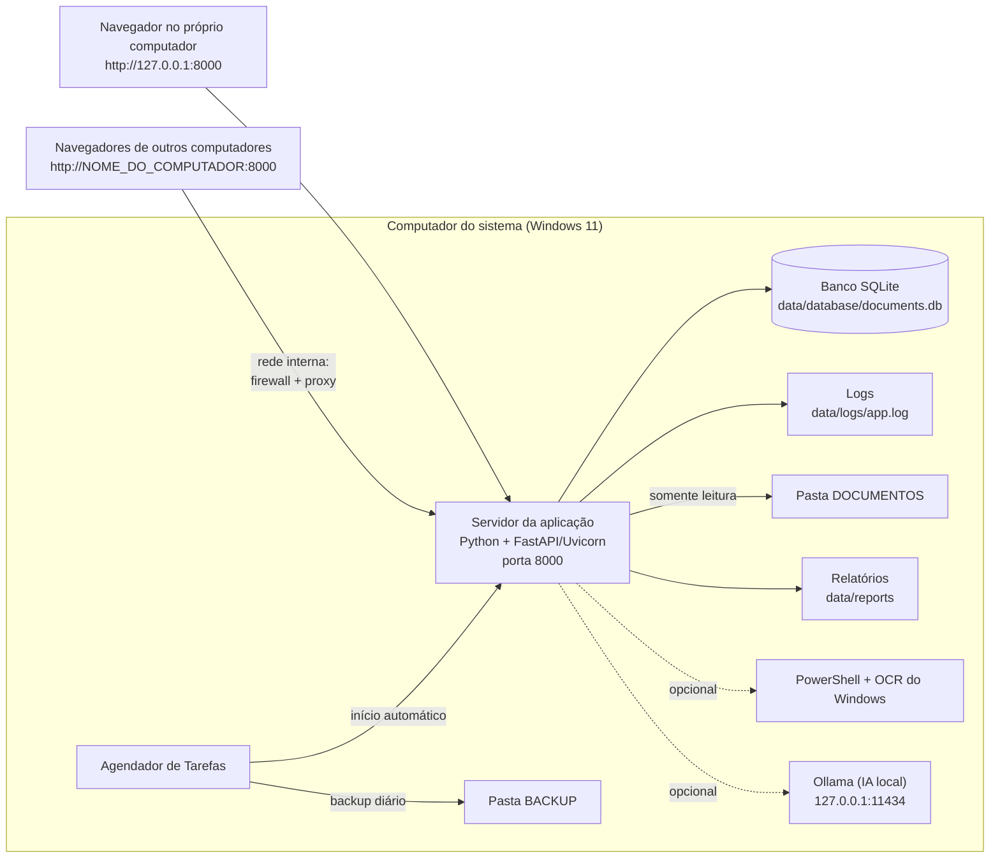

# Manual Técnico de Manutenção e Migração — Agente de Inteligência Documental

| | |
|---|---|
| **Sistema** | Agente de Inteligência Documental — Contratos e Checklists |
| **Versão documentada** | 1.0.0 |
| **Data de criação deste manual** | 14/10/2026 |
| **Público** | Analista de TI, inclusive iniciante e sem contato prévio com o código |
| **Computador de referência** | Windows 11 Pro 64 bits, Python 3.15.0, pasta `D:\AGENTES\INTELIGENCIA_DOCUMENTAL_GESTAO_ CONTRATO` |

> O uso do sistema (telas, perguntas, checklists) está no [Manual do Usuário](MANUAL_DO_USUARIO.md). Detalhes de
> código estão em [legado/ARQUITETURA_v1.md](legado/ARQUITETURA_v1.md).

## Sumário

0. [Antes de começar: habilidades básicas](#0-antes-de-começar-habilidades-básicas)
1. [Visão geral da arquitetura](#1-visão-geral-da-arquitetura)
2. [Inventário técnico](#2-inventário-técnico)
3. [Estrutura de pastas](#3-estrutura-de-pastas)
4. [Variáveis de ambiente e configurações](#4-variáveis-de-ambiente-e-configurações)
5. [Instalação do zero em um computador novo](#5-instalação-do-zero-em-um-computador-novo)
6. [Procedimento de migração para outro computador](#6-procedimento-de-migração-para-outro-computador)
7. [Backup e restauração](#7-backup-e-restauração)
8. [Operação do dia a dia](#8-operação-do-dia-a-dia)
9. [Diagnóstico e solução de problemas](#9-diagnóstico-e-solução-de-problemas)
10. [Atualização de dependências e segurança](#10-atualização-de-dependências-e-segurança)
11. [Contatos e acessos](#11-contatos-e-acessos)
12. [Glossário técnico](#12-glossário-técnico)

---

## 0. Antes de começar: habilidades básicas

Esta seção explica o que outras seções pressupõem. Volte aqui sempre que um passo pedir uma dessas ações.

### 0.1 Pasta do sistema

Neste manual, **pasta do sistema** significa:

```text
D:\AGENTES\INTELIGENCIA_DOCUMENTAL_GESTAO_ CONTRATO
```

> ⚠️ ATENÇÃO: o nome da pasta tem um **espaço** antes de `CONTRATO` (`GESTAO_ CONTRATO`). Por isso, nos comandos, o
> caminho aparece **sempre entre aspas**. Se você digitar sem aspas, o comando falha.

Se o sistema estiver em outra pasta (por exemplo, depois de uma migração), substitua esse caminho pelo novo em todos
os comandos.

### 0.2 Abrir o Explorador de Arquivos e ir até uma pasta

1. Pressione as teclas **Windows + E** ao mesmo tempo.
2. Clique na **barra de endereço** (alto da janela, onde aparece "Este Computador" ou um caminho).
3. Cole ou digite o caminho da pasta, por exemplo `D:\AGENTES\INTELIGENCIA_DOCUMENTAL_GESTAO_ CONTRATO`.
4. Pressione **Enter**.

### 0.3 Abrir o PowerShell (o terminal)

O **PowerShell** é uma janela de texto onde se digitam comandos. É o "terminal" do Windows.

**PowerShell comum:**

1. Clique no botão **Iniciar** (ícone do Windows na barra de tarefas).
2. Digite `PowerShell`.
3. Clique em **Windows PowerShell**.

**PowerShell como administrador** (necessário quando o passo indicar):

1. Clique no botão **Iniciar**.
2. Digite `PowerShell`.
3. Clique com o **botão direito** em **Windows PowerShell**.
4. Clique em **Executar como administrador**.
5. Na pergunta "Deseja permitir que este aplicativo faça alterações…", clique em **Sim** (pode pedir a senha de um
   administrador do Windows).

O título da janela começa com **Administrador:** quando está em modo administrador.

### 0.4 Entrar na pasta do sistema pelo PowerShell

Quase todos os comandos deste manual começam com este:

```powershell
Set-Location "D:\AGENTES\INTELIGENCIA_DOCUMENTAL_GESTAO_ CONTRATO"
```

- **O que faz:** muda a pasta de trabalho do PowerShell para a pasta do sistema.
- **Se der certo:** a linha de comando passa a mostrar `PS D:\AGENTES\INTELIGENCIA_DOCUMENTAL_GESTAO_ CONTRATO>`.
- **Se der errado** ("Não é possível localizar o caminho"): confira o caminho no Explorador de Arquivos (0.2) e as
  aspas.

### 0.5 Copiar, colar e executar comandos

1. Selecione o comando neste manual e copie (**Ctrl + C**).
2. Clique dentro da janela do PowerShell.
3. Cole com **Ctrl + V** (ou clique com o botão direito).
4. Substitua as partes indicadas em MAIÚSCULAS (ex.: `SEU_USUARIO`).
5. Pressione **Enter**.

### 0.6 Editar um arquivo de texto (como o `.env`)

1. Abra a pasta do sistema no Explorador de Arquivos (0.2).
2. Clique com o botão direito no arquivo (ex.: `.env`).
3. Clique em **Abrir com** → **Bloco de Notas**. Se não aparecer, clique em **Escolher outro aplicativo** → **Bloco de
   Notas**.
4. Faça a alteração.
5. Salve com **Ctrl + S**.

> Se o arquivo `.env` não aparecer: no Explorador de Arquivos, clique em **Exibir** → **Mostrar** → **Extensões de
> nomes de arquivos** e **Itens ocultos**.

### 0.7 Executar um arquivo `.bat`

- **Pelo Explorador:** dê um duplo clique no arquivo (ex.: `diagnostico.bat`).
- **Pelo PowerShell** (já na pasta do sistema, item 0.4): digite `.\nome.bat` e Enter, por exemplo `.\diagnostico.bat`.

---

## 1. Visão geral da arquitetura

### Em linguagem simples

O sistema é um **programa em Python** que roda no **computador do sistema** (hoje, o computador onde está a pasta
acima). Enquanto está em execução, ele funciona como um **pequeno servidor web** na **porta 8000**: os usuários abrem um
**navegador** e acessam as telas.

- O programa **lê** os documentos da pasta `DOCUMENTOS` (nunca altera).
- Tudo o que ele produz (índice de busca, usuários, checklists, configurações) fica num **único arquivo de banco de
  dados** (`data\database\documents.db`), do tipo **SQLite**: não existe "servidor de banco" separado.
- Os **logs** (registros do que aconteceu) ficam em `data\logs\app.log`.
- O **OCR** (leitura de digitalizados) usa o mecanismo do próprio Windows, chamado pelo PowerShell.
- A **IA** é opcional e, se instalada, roda no mesmo computador (programa **Ollama**).
- O **backup** é um arquivo `.zip` criado pelo `backup.bat`, que pode ser agendado.



### Como uma pergunta é respondida

1. O usuário digita a pergunta no navegador.
2. O navegador envia a pergunta ao servidor (porta 8000), junto com o "cookie" de sessão do login.
3. O servidor confere quem é o usuário e se o computador de origem é autorizado.
4. O servidor procura os trechos no índice (banco SQLite).
5. As regras do sistema montam a resposta (fato, inferência, conflito ou ausência).
6. Se a IA estiver ativada, ela redige o texto e o sistema confere números e datas nos documentos.
7. A resposta volta ao navegador com as fontes.

### O que NÃO existe neste sistema ("Não se aplica")

| Item comum em sistemas web | Situação neste sistema |
|---|---|
| Servidor web separado (Nginx, Apache, IIS) | **Não se aplica.** O próprio programa (Uvicorn) atende as conexões. |
| Proxy reverso | **Não se aplica.** Os navegadores acessam diretamente a porta 8000. |
| Domínio público, DNS público | **Não se aplica.** O acesso é pela rede interna, pelo nome ou IP do computador. Um nome interno (DNS interno da SEMA) é opcional — `[VERIFICAR: se a TI criará um nome como agente.sema.mt.gov.br]`. |
| Certificado SSL público | **Não se aplica.** HTTPS é **opcional**, com certificado fornecido pela TI (seção 5.9). |
| Servidor de banco de dados (MySQL, PostgreSQL, SQL Server) | **Não se aplica.** O banco é o arquivo SQLite. |
| Envio de e-mails | **Não se aplica.** Não há e-mail; senhas são redefinidas por administradores. |
| Cron jobs (Linux) | **Não se aplica.** O equivalente no Windows é o **Agendador de Tarefas** (seções 5.8 e 5.10). |
| Filas, cache (Redis), serviços de nuvem | **Não se aplica.** |
| Docker, WSL, Node.js | **Não se aplica.** Por decisão de projeto, não são usados. |

---

## 2. Inventário técnico

Versões **exatas** instaladas no computador de referência em 14/10/2026. O arquivo `requirements.txt` define versões
**mínimas**; numa reinstalação podem ser instaladas versões mais novas (veja a seção 10).

| Tecnologia | Versão | Função no sistema | Documentação / download |
|---|---|---|---|
| Windows 11 Pro 64 bits | 10.0.26100 | Sistema operacional (único suportado) | <https://www.microsoft.com/windows> |
| Windows PowerShell | 5.1 (nativo) | Executa o OCR do Windows e os comandos deste manual | <https://learn.microsoft.com/powershell/> |
| Python | 3.15.0 | Linguagem do sistema | <https://www.python.org/downloads/windows/> |
| FastAPI | 0.143.1 | Estrutura do servidor web e da API | <https://fastapi.tiangolo.com/> |
| Starlette | 1.8.0 | Base do FastAPI (requisições, arquivos estáticos) | <https://www.starlette.io/> |
| Uvicorn | 0.54.0 | Servidor que atende a porta 8000 | <https://www.uvicorn.org/> |
| Pydantic | 2.14.1 | Validação dos dados recebidos | <https://docs.pydantic.dev/> |
| python-dotenv | 1.2.4 | Leitura do arquivo `.env` | <https://pypi.org/project/python-dotenv/> |
| SQLite (embutido no Python) | 3.53.4 | Banco de dados e busca de texto (FTS5) | <https://www.sqlite.org/> |
| pypdf | 6.20.1 | Leitura de PDF | <https://pypdf.readthedocs.io/> |
| python-docx | 1.2.0 | Leitura de DOCX | <https://python-docx.readthedocs.io/> |
| openpyxl | 3.1.5 | Leitura de XLSX e geração de relatórios Excel | <https://openpyxl.readthedocs.io/> |
| xlrd | 2.0.2 | Leitura de XLS (Excel 97-2003) | <https://xlrd.readthedocs.io/> |
| olefile | 0.47 | Leitura de DOC e PPT (Office 97-2003) | <https://olefile.readthedocs.io/> |
| pypdfium2 | 5.14.0 | Converte páginas de PDF digitalizado em imagem (OCR) | <https://pypdfium2.readthedocs.io/> |
| Pillow | 12.3.0 | Tratamento de imagens | <https://pillow.readthedocs.io/> |
| fpdf2 (+ fonttools 4.67.0) | 2.8.9 | Relatórios em PDF | <https://py-pdf.github.io/fpdf2/> |
| defusedxml | 0.7.1 | Leitura segura de XML (ODT, ODS, PPTX) | <https://pypi.org/project/defusedxml/> |
| lxml | 6.1.3 | Dependência do python-docx | <https://lxml.de/> |
| pytest / httpx | 9.1.1 / 0.28.1 | Testes automatizados (não necessários para usar) | <https://docs.pytest.org/> |
| OCR do Windows (idioma pt-BR) | nativo | Reconhecimento de texto em digitalizados | <https://learn.microsoft.com/uwp/api/windows.media.ocr> |
| Tesseract OCR | não instalado | Alternativa opcional de OCR | <https://github.com/UB-Mannheim/tesseract/wiki> |
| Ollama | não instalado | IA local opcional | <https://ollama.com/download> |
| Microsoft Edge | o instalado no Windows | Navegador recomendado | — |

---

## 3. Estrutura de pastas

| Caminho (dentro da pasta do sistema) | O que contém | Pode apagar? |
|---|---|---|
| `app\` | Código do sistema (Python). | ❌ Nunca |
| `frontend\` | Telas (HTML, CSS, JavaScript). | ❌ Nunca |
| `scripts\` | Ferramentas: indexar, diagnóstico, backup, restauração, usuários, aceitação, exemplos. | ❌ Nunca |
| `tests\` | Testes automatizados e arquivos de teste fictícios. | Não recomendado |
| `docs\` | Manuais e documentação técnica. | Não recomendado |
| `data\database\documents.db` | **Banco de dados**: usuários, índice, checklists, configurações feitas no painel. | ❌ **Nunca** (só restaurar de backup) |
| `data\database\documents.db-wal` e `-shm` | Arquivos auxiliares do banco enquanto ele está em uso. | ❌ Nunca com o sistema rodando |
| `data\logs\` | Logs (`app.log` e cópias `app.log.1` … `app.log.5`). | Sim, os antigos (`.1`–`.5`) |
| `data\reports\` | Relatórios gerados pelos usuários. | Sim, se não forem mais necessários |
| `data\cache\` | Arquivos temporários do OCR (apagados automaticamente). | Sim, com o sistema parado |
| `data\backups\` | Backups antigos feitos sem destino definido. | Sim, depois de conferir |
| `data\app.pid` | Identificação do processo em execução (usado pelo `stop.bat`). | Só se o sistema estiver parado |
| `DOCUMENTOS\` | **Documentos analisados** (os originais). | ❌ Nunca pelo sistema; gestão é dos usuários |
| `BACKUP\` | Backups criados pelo `backup.bat`. | Os mais antigos são apagados automaticamente (mantém 30) |
| `exemplos\` | Documentos fictícios de demonstração. | Sim |
| `.venv\` | **Ambiente virtual**: o Python e as bibliotecas do sistema. | Pode ser recriado com `instalar.bat` |
| `.env` | **Configuração local** (porta, rede, OCR, IA). | ❌ Nunca (faça cópia antes de editar) |
| `.env.example` | Modelo de configuração com todas as opções. | ❌ Nunca |
| `requirements.txt` | Lista de bibliotecas a instalar. | ❌ Nunca |
| `instalar.bat` | Instalação e reinstalação. | ❌ Nunca |
| `start.bat` | Inicia o sistema com janela e abre o navegador. | ❌ Nunca |
| `servidor.bat` | Inicia o sistema sem janela (usado no início automático). | ❌ Nunca |
| `stop.bat` | Para o sistema de forma controlada. | ❌ Nunca |
| `diagnostico.bat` | Verificação do ambiente. | ❌ Nunca |
| `backup.bat` | Backup para a pasta `BACKUP` (mantém 30). | ❌ Nunca |
| `usuarios.bat` | Gestão de usuários pelo terminal (recuperação de acesso). | ❌ Nunca |
| `aceitacao.bat` | Teste de aceitação com documentos fictícios. | ❌ Nunca |
| `CLAUDE.md`, `README.md` | Especificação vigente (SAD-GD) e visão geral. | Não recomendado |

> ℹ️ A especificação original v1 foi arquivada em `docs/legado/AGENTS_v1.md` (reestruturação SAD-GD, 2026-11-16).

---

## 4. Variáveis de ambiente e configurações

### 4.1 O que é o `.env`

O `.env` é um arquivo de texto na pasta do sistema, uma configuração por linha, no formato `NOME=valor`. Ele é lido
quando o sistema **inicia**: **toda alteração exige reiniciar o sistema** (seção 8.3). O modelo completo, com
comentários, está em `.env.example`.

> ⚠️ ATENÇÃO: o `.env` do computador de referência foi criado antes das versões com OCR, IA e acesso pela rede e
> contém só 9 variáveis. As ausentes usam o valor padrão (coluna "Exemplo/padrão"). Para ajustar uma delas, copie a
> linha do `.env.example` para o `.env`.

| Variável | Função | Obrigatória | Exemplo / padrão | Consequência se estiver errada |
|---|---|---|---|---|
| `APP_HOST` | Onde o servidor "escuta": `127.0.0.1` só aceita o próprio computador; `0.0.0.0` aceita outros computadores. | Não | `127.0.0.1` | Valor inválido: o sistema não inicia. `127.0.0.1` com acesso pela rede desejado: os outros computadores não conseguem acessar. |
| `APP_PORT` | Porta de acesso. | Não | `8000` | Porta já usada por outro programa: o sistema não inicia. Os usuários precisam usar a nova porta no endereço. |
| `ALLOWED_CLIENTS` | Faixas de endereços IP autorizadas no acesso pela rede, separadas por vírgula. O próprio computador é sempre aceito. | Não | `127.0.0.1/32,::1/128,10.0.0.0/8,172.16.0.0/12,192.168.0.0/16` | Faixa faltando: usuários recebem "Este computador não está autorizado". Faixa ampla demais: computadores indevidos alcançam a tela de login. Faixa inválida é ignorada (aviso no log). |
| `ALLOWED_HOSTS` | Nomes adicionais usados no endereço (ex.: nome DNS interno). Nome e IPs do computador já são aceitos. | Não | `agente.sema.mt.gov.br` | Nome usado pelos usuários não listado: "Endereço de acesso não reconhecido". |
| `SESSION_HOURS` | Horas até o login expirar. | Não | `8` | Muito alto: sessões esquecidas ficam abertas; não numérico: o sistema não inicia. |
| `SSL_CERTFILE` | Caminho do certificado HTTPS (formato PEM). | Não (recomendado na rede) | `D:\certificados\agente.crt` | Caminho errado: o sistema não inicia; o diagnóstico acusa ERRO. |
| `SSL_KEYFILE` | Caminho da chave privada do certificado (PEM). | Junto com `SSL_CERTFILE` | `D:\certificados\agente.key` | Idem. |
| `DOCUMENTS_ROOT` | Pasta dos documentos (valor inicial; o painel prevalece). | Não | `D:\AGENTES\INTELIGENCIA_DOCUMENTAL_GESTAO_ CONTRATO\DOCUMENTOS` | Pasta inexistente: ponto amarelo "Diretório documental indisponível"; nada é indexado. |
| `DATABASE_PATH` | Arquivo do banco. | Não | `.\data\database\documents.db` | Caminho diferente: o sistema cria um banco **vazio** (parece que tudo sumiu). |
| `DATA_DIR` | Pasta de trabalho (logs, cache, relatórios, backups padrão). | Não | `.\data` | Pasta sem permissão de escrita: o sistema não inicia. |
| `LOG_LEVEL` | Detalhe dos logs: `INFO`, `WARNING`, `ERROR`, `DEBUG`. | Não | `INFO` | `DEBUG` gera logs muito grandes; valor inválido: o sistema não inicia. |
| `AUTO_INDEX` | Atualiza o índice automaticamente ao iniciar. | Não | `true` | `false`: documentos novos só aparecem após "Atualizar índice". |
| `OCR_ENABLED` | Ativa o OCR (o painel prevalece). | Não | `true` | `false`: digitalizados ficam sem texto. |
| `OCR_ENGINE` | `auto`, `windows` ou `tesseract`. | Não | `auto` | Mecanismo indisponível: OCR não funciona (diagnóstico avisa). |
| `OCR_LANGUAGE` | Idioma do OCR do Windows. | Não | `pt-BR` | Idioma não instalado: OCR indisponível. |
| `OCR_DPI` | Resolução para ler PDF digitalizado. | Não | `200` | Muito alto (> 300): lento e consome memória. Muito baixo (< 150): erros de leitura. |
| `OCR_MAX_PAGES` | Páginas máximas com OCR por documento. | Não | `50` | Baixo: páginas finais de documentos longos ficam sem texto. |
| `TESSERACT_CMD` | Caminho do `tesseract.exe` (opcional). | Não | `C:\Program Files\Tesseract-OCR\tesseract.exe` | Caminho errado: Tesseract indisponível. |
| `TESSERACT_LANG` | Idioma do Tesseract. | Não | `por` | Idioma não instalado: Tesseract indisponível. |
| `AI_PROVIDER` | `local` (sem IA) ou `llm_local` (IA local); o painel prevalece. | Não | `local` | `llm_local` sem Ollama: respostas usam o modo sem IA, com aviso. |
| `LLM_BASE_URL` | Endereço do Ollama/LM Studio. | Não | `http://127.0.0.1:11434/v1` | Endereço externo: recusado (modo LOCAL ONLY). Porta errada: "IA indisponível". |
| `LLM_MODEL` | Modelo de IA (o painel prevalece). | Não | `qwen2.5:7b` | Modelo não instalado: "Modelo ou endereço não encontrado". |
| `LLM_TIMEOUT` | Tempo máximo de espera da IA (segundos). | Não | `120` | Baixo: respostas longas são abandonadas ("IA indisponível"). |
| `LLM_MAX_PASSAGES` | Trechos enviados à IA por pergunta. | Não | `8` | Alto: respostas mais lentas. |
| `AI_ALLOW_REMOTE` | Permite IA fora deste computador. | Não | `false` | `true` sem autorização institucional: risco de envio de dados para fora. **Mantenha `false`.** |
| `OPENAI_API_KEY` | Reservado, não utilizado. | Não | vazio | Nenhuma. **Nunca grave chaves reais.** |

### 4.2 Configurações feitas pelo painel (ficam no banco)

Algumas configurações alteradas na tela **Configurações** ficam gravadas na tabela `settings` do banco e
**prevalecem sobre o `.env`**:

| Configuração no painel | Chave no banco | Substitui no `.env` |
|---|---|---|
| Diretório documental | `documents_root` | `DOCUMENTS_ROOT` |
| Ativar OCR / mecanismo | `ocr_enabled`, `ocr_engine` | `OCR_ENABLED`, `OCR_ENGINE` |
| Mecanismo de respostas, endereço, modelo | `ai_provider`, `llm_base_url`, `llm_model` | `AI_PROVIDER`, `LLM_BASE_URL`, `LLM_MODEL` |

> Consequência: se você mudar `DOCUMENTS_ROOT` no `.env` e nada acontecer, é porque o painel já tem um valor gravado.
> Altere pelo painel (Manual do Usuário, seção 5.7).

### 4.3 Usuários e senhas

- Os usuários ficam na tabela `users` do banco. As senhas são guardadas **apenas como hash PBKDF2** (não dá para
  "ler" a senha).
- **Não existem senhas, tokens ou chaves gravados no código ou no `.env`.**
- O backup contém os hashes: **guarde os backups com o mesmo cuidado que o banco**.

---

## 5. Instalação do zero em um computador novo

**Sistema operacional de referência:** Windows 11 Pro 64 bits, recém-instalado, ingressado no domínio da SEMA e com
acesso à Internet (para baixar o Python e as bibliotecas).

`[VERIFICAR: se a instalação puder ser feita em Windows Server, confirmar a versão com a TI; o sistema foi testado
somente no Windows 11 Pro]`

**Tempo estimado:** 30 a 60 minutos (sem IA); mais 30 minutos com IA local (download do modelo).

### 5.1 Pré-requisitos

1. Conta com permissão de administrador no computador (para instalar o Python, liberar o firewall e criar tarefas).
2. Acesso à Internet a partir do computador, inclusive através do **proxy** institucional.
   `[VERIFICAR: endereço e porta do proxy da SEMA, caso o pip precise dele]`
3. Disco `D:` com pelo menos **5 GB livres** (sem IA) ou **15 GB livres** (com IA local).
4. Autorização da equipe de segurança, porque o **CrowdStrike** pode bloquear o Python ou o PowerShell
   (seção 9.15).

### 5.2 Instalar o Python 3.15

1. No navegador, acesse <https://www.python.org/downloads/windows/>.
2. Baixe o instalador do **Python 3.15** para Windows 64 bits.
   `[VERIFICAR: a partir do Python 3.14 o python.org passou a oferecer o "Python install manager"; confirmar o
   instalador indicado para 3.15 e se ele permite instalar "para todos os usuários"]`
3. Execute o instalador.
4. Marque a opção **Add python.exe to PATH** (adicionar ao PATH).
5. Se houver a opção **Install for all users** (instalar para todos os usuários), marque-a.
   Isso é importante quando o sistema roda pelo Agendador de Tarefas com outra conta (seção 5.8).
6. Conclua a instalação.
7. **Feche** todas as janelas do PowerShell e abra uma nova (0.3).
8. Confirme a instalação:

```powershell
python --version
```

- **O que faz:** mostra a versão do Python encontrada.
- **Se der certo:** aparece `Python 3.15.0` (ou 3.15.x).
- **Se der errado:** "python não é reconhecido…": o Python não está no PATH. Reinstale marcando **Add python.exe to
  PATH**, ou reinicie o computador. Se abrir a **Microsoft Store**, desative o atalho em **Configurações → Aplicativos →
  Configurações avançadas de aplicativos → Aliases de execução de aplicativo** → desligue "python.exe" e
  "python3.exe".

> O sistema exige Python **3.10 ou superior** e foi testado no **3.15.0**. Prefira a mesma versão.

### 5.3 Copiar a pasta do sistema

**Hoje (pasta copiada):**

1. Obtenha a pasta do sistema (pendrive, pasta de rede ou arquivo `.zip`) **sem** a subpasta `.venv`.
2. Copie para `D:\AGENTES\INTELIGENCIA_DOCUMENTAL_GESTAO_ CONTRATO` (crie `D:\AGENTES` se não existir).
3. Se recebeu um `.zip`, clique com o botão direito → **Extrair tudo…** → escolha `D:\AGENTES`.

**No futuro (Git):** `[VERIFICAR: endereço do repositório Git quando ele existir]`

```powershell
git clone ENDERECO_DO_REPOSITORIO "D:\AGENTES\INTELIGENCIA_DOCUMENTAL_GESTAO_ CONTRATO"
```

- **O que faz:** baixa o código do repositório para a pasta indicada. Substitua `ENDERECO_DO_REPOSITORIO` pelo
  endereço informado pela equipe responsável.
- **Se der certo:** aparece "Cloning into…" e termina sem erro.
- **Se der errado:** "git não é reconhecido": instale o Git (<https://git-scm.com/download/win>). Erro de acesso:
  peça permissão ao responsável pelo repositório.

> O Git **não** traz `.env`, `data\`, `DOCUMENTOS\`, `BACKUP\` nem `.venv\` (estão no `.gitignore`). Esses itens vêm
> da migração (seção 6) ou são criados na instalação.

### 5.4 Executar o instalador

1. Abra a pasta do sistema no Explorador de Arquivos (0.2).
2. Dê um duplo clique em **`instalar.bat`**.
3. Aguarde as 9 etapas (a etapa 5, de dependências, pode levar alguns minutos).
4. Ao final, deve aparecer `[OK] Instalacao concluida.` e a lista do diagnóstico com `Resultado: 0 erro(s)`.
5. Pressione qualquer tecla para fechar.

O que o instalador faz: verifica Windows e Python → cria `.venv` → cria as pastas de `data\` → instala o
`requirements.txt` → cria o `.env` a partir do `.env.example` (se não existir) → testa importações → executa o
diagnóstico.

| Mensagem | Causa | Solução |
|---|---|---|
| `[ERRO] Python nao encontrado no PATH.` | Python não instalado ou fora do PATH. | Seção 5.2. |
| `[ERRO] E necessario Python 3.10 ou superior.` | Python antigo. | Instale o 3.15. |
| `[ERRO] Falha ao instalar as dependencias.` | Sem Internet, proxy bloqueando ou CrowdStrike. | Seção 9.16 (proxy) e 9.15 (CrowdStrike). |
| `[ERRO] A aplicacao nao pode ser carregada.` | Biblioteca incompatível ou arquivo faltando. | Leia a mensagem acima dela; reexecute `instalar.bat`; seção 9.11. |

### 5.5 Criar as pastas de documentos e de backup

1. Abra o PowerShell (0.3).
2. Execute:

```powershell
New-Item -ItemType Directory -Force "D:\AGENTES\INTELIGENCIA_DOCUMENTAL_GESTAO_ CONTRATO\DOCUMENTOS", "D:\AGENTES\INTELIGENCIA_DOCUMENTAL_GESTAO_ CONTRATO\BACKUP"
```

- **O que faz:** cria as pastas `DOCUMENTOS` e `BACKUP` (não apaga nada se já existirem).
- **Se der certo:** lista as duas pastas com a coluna `Mode` igual a `d-----`.
- **Se der errado:** "Acesso negado": abra o PowerShell como administrador (0.3).

3. Copie os documentos de contratos para a pasta `DOCUMENTOS` (pode usar subpastas).

### 5.6 Ajustar o `.env`

1. Abra o `.env` no Bloco de Notas (0.6).
2. Confira ou ajuste a linha do diretório documental:

```text
DOCUMENTS_ROOT=D:\AGENTES\INTELIGENCIA_DOCUMENTAL_GESTAO_ CONTRATO\DOCUMENTOS
```

3. Se o `.env` não tiver as linhas de rede, OCR e IA, copie-as do `.env.example` (seção 4.1).
4. Salve (**Ctrl + S**).

> No `.env`, **não** use aspas no valor, mesmo com o espaço no caminho.

### 5.7 Primeiro início e criação do administrador

1. Dê um duplo clique em **`start.bat`**. Uma janela preta abre e **deve ficar aberta**.
2. O navegador abre em `http://127.0.0.1:8000` com a tela **Configuração inicial**.
3. Crie o primeiro administrador (Manual do Usuário, seção 3.1).
4. Vá em **Configurações** → **Diretório documental**, confira o caminho da pasta `DOCUMENTOS` e clique em **Salvar**.
5. Clique em **Iniciar indexação** e aguarde no **Painel**.
6. Em **Configurações** → **OCR**, marque **Ativar OCR**, clique em **Salvar** e em **Testar OCR** (deve dar `[OK]`).
7. Em **Configurações**, clique em **Verificar sistema**: tudo deve estar **OK**. (Pelo `diagnostico.bat`, com o
   sistema rodando, o aviso `porta 8000: em uso` é normal.)
8. Para encerrar este teste, feche o navegador e dê um duplo clique em **`stop.bat`**.

Se a tela de configuração inicial não aparecer porque já existe usuário (banco restaurado), apenas entre com um
administrador existente.

### 5.8 Início automático com o Windows (Agendador de Tarefas)

Como várias pessoas usam o sistema pela rede, ele precisa iniciar sozinho quando o computador liga, **sem depender de
alguém fazer login**. Isso é feito pelo **Agendador de Tarefas** do Windows (o equivalente ao "systemd"/"cron" de
servidores Linux).

> ⚠️ ATENÇÃO: com o início automático configurado, **não** use também o `start.bat`. Dois sistemas ao mesmo tempo
> disputam a porta 8000 e o segundo não inicia.

**Pela interface gráfica:**

1. Clique em **Iniciar**, digite `Agendador de Tarefas` e abra-o.
2. No painel direito, clique em **Criar Tarefa…** (não "Criar Tarefa Básica").
3. Aba **Geral**:
   1. Em **Nome**, digite `Agente Documental - Servidor`.
   2. Clique em **Alterar Usuário ou Grupo…**, digite `SYSTEM`, clique em **Verificar Nomes** e em **OK**.
      `[VERIFICAR: se a política da SEMA permite tarefas com a conta SYSTEM; alternativa: uma conta de serviço do
      domínio com permissão de leitura nas pastas]`
   3. Marque **Executar com privilégios mais altos**.
4. Aba **Disparadores**:
   1. Clique em **Novo…**.
   2. Em **Iniciar a tarefa**, escolha **Na inicialização**.
   3. Marque **Atrasar a tarefa por** e escolha **1 minuto** (dá tempo à rede de subir).
   4. Clique em **OK**.
5. Aba **Ações**:
   1. Clique em **Novo…**.
   2. Em **Programa/script**, digite `cmd.exe`.
   3. Em **Adicionar argumentos**, digite (com as aspas):
      `/c "D:\AGENTES\INTELIGENCIA_DOCUMENTAL_GESTAO_ CONTRATO\servidor.bat"`
   4. Em **Iniciar em**, digite (sem aspas):
      `D:\AGENTES\INTELIGENCIA_DOCUMENTAL_GESTAO_ CONTRATO`
   5. Clique em **OK**.
6. Aba **Condições**: desmarque **Iniciar a tarefa somente se o computador estiver ligado à rede elétrica**.
7. Aba **Configurações**:
   1. Desmarque **Interromper a tarefa se ela for executada por mais de**.
   2. Marque **Se a tarefa falhar, reiniciar a cada** → **1 minuto**, **3** tentativas.
8. Clique em **OK**.
9. Para iniciar agora sem reiniciar o computador: clique com o botão direito na tarefa → **Executar**.

> 📷 [CAPTURA DE TELA: janela "Criar Tarefa" do Agendador, aba Ações, com Programa/script "cmd.exe", argumentos
> "/c "D:\...\servidor.bat"" e Iniciar em preenchido]

**Pelo PowerShell (alternativa, como administrador):**

```powershell
$acao = New-ScheduledTaskAction -Execute "cmd.exe" -Argument '/c "D:\AGENTES\INTELIGENCIA_DOCUMENTAL_GESTAO_ CONTRATO\servidor.bat"' -WorkingDirectory "D:\AGENTES\INTELIGENCIA_DOCUMENTAL_GESTAO_ CONTRATO"
$gatilho = New-ScheduledTaskTrigger -AtStartup
$gatilho.Delay = "PT1M"
$opcoes = New-ScheduledTaskSettingsSet -ExecutionTimeLimit ([TimeSpan]::Zero) -RestartCount 3 -RestartInterval (New-TimeSpan -Minutes 1) -AllowStartIfOnBatteries -DontStopIfGoingOnBatteries
Register-ScheduledTask -TaskName "Agente Documental - Servidor" -Action $acao -Trigger $gatilho -Settings $opcoes -User "SYSTEM" -RunLevel Highest
```

- **O que faz:** cria a tarefa que executa `servidor.bat` 1 minuto após o computador ligar, sem limite de duração e
  com até 3 novas tentativas em caso de falha.
- **Se der certo:** aparece uma tabela com `TaskName` = `Agente Documental - Servidor` e `State` = `Ready`.
- **Se der errado:** "Acesso negado": o PowerShell não está como administrador. "A tarefa já existe": ela já foi
  criada; para recriar, apague-a antes com
  `Unregister-ScheduledTask -TaskName "Agente Documental - Servidor" -Confirm:$false`.

**Conferir se o sistema subiu:**

```powershell
Start-ScheduledTask -TaskName "Agente Documental - Servidor"
Start-Sleep -Seconds 15
Invoke-RestMethod http://127.0.0.1:8000/health
```

- **O que faz:** executa a tarefa, espera 15 segundos e consulta a saúde do sistema.
- **Se der certo:** aparece `status : ok` (ou `atencao`), `database : ok`.
- **Se der errado:** "Impossível conectar-se ao servidor remoto": veja `data\logs\servidor_console.log` e a seção 9.1.

**Limitações do início automático (conta SYSTEM):**

- O botão **Selecionar pasta…** não abre janela (não há tela para a conta SYSTEM): digite o caminho.
- **Abrir no Windows** abre o arquivo "em segundo plano", invisível para quem está no computador: use **Visualizar**.
- O OCR do Windows sob a conta SYSTEM: `[VERIFICAR: executar "Testar OCR" no painel após configurar o início
  automático; se falhar, usar uma conta de serviço com perfil de usuário]`.
- A IA local (Ollama) precisa estar em execução: veja a seção 5.11.

### 5.9 Liberar o acesso pela rede (vários usuários)

> ⚠️ ATENÇÃO: liberar o acesso pela rede expõe os documentos indexados a todos os computadores autorizados (mediante
> login). Obtenha a **autorização da área de segurança da informação** antes. `[VERIFICAR: autorização formal]`

**Passo 1 — Descobrir o nome e o IP do computador do sistema**

```powershell
hostname
Get-NetIPAddress -AddressFamily IPv4 | Where-Object { $_.IPAddress -notlike "127.*" -and $_.IPAddress -notlike "169.254.*" -and $_.InterfaceAlias -notlike "*Loopback*" } | Select-Object IPAddress, InterfaceAlias
```

- **O que faz:** mostra o nome do computador e seus endereços IP na rede (ignora adaptadores internos/virtuais do
  tipo "Loopback", como o de plugins de segurança bancária).
- **Se der certo:** o nome (ex.: `SEMA-PC0123`) e um ou mais IPs, com o tipo de conexão (ex.: `172.16.110.45`
  **Ethernet**). Use o IP da conexão **Ethernet** (cabo), que é a mais estável; o de **Wi-Fi** pode mudar.
- **Se der errado:** se nenhum IP aparecer, o computador não está na rede; verifique o cabo/Wi-Fi.

> Peça à TI que o IP seja **fixo** (reserva de DHCP) ou que exista um **nome DNS interno** para o computador, para o
> endereço não mudar. `[VERIFICAR: IP fixo ou nome DNS interno definido pela TI]`

**Passo 2 — Ajustar o `.env`**

1. Abra o `.env` (0.6).
2. Altere ou acrescente as linhas:

```text
APP_HOST=0.0.0.0
ALLOWED_CLIENTS=FAIXA_DA_REDE_DA_SEMA
ALLOWED_HOSTS=NOME_DNS_INTERNO
```

- Substitua `FAIXA_DA_REDE_DA_SEMA` pela faixa da rede onde estão os usuários, no formato `10.20.0.0/16` (várias
  separadas por vírgula). `[VERIFICAR: faixas de IP da rede da SEMA, informadas pela TI]` Se deixar a linha sem
  alterar, valem todas as redes internas privadas.
- Substitua `NOME_DNS_INTERNO` pelo nome DNS criado pela TI (ex.: `agente.sema.mt.gov.br`) ou apague a linha se os
  usuários acessarem pelo nome do computador ou IP.

3. Salve.

**Passo 3 — Liberar a porta no Firewall do Windows** (PowerShell **como administrador**)

```powershell
New-NetFirewallRule -DisplayName "Agente Documental (porta 8000)" -Direction Inbound -Protocol TCP -LocalPort 8000 -Action Allow -Profile Domain -RemoteAddress FAIXA_DA_REDE_DA_SEMA
```

- **O que faz:** cria uma regra no Firewall do Windows permitindo conexões de entrada na porta 8000, somente na rede
  do domínio e somente a partir da faixa informada. Substitua `FAIXA_DA_REDE_DA_SEMA` (ex.: `10.20.0.0/16`).
- **Se der certo:** aparece a descrição da regra com `Enabled : True`.
- **Se der errado:** "Acesso negado": PowerShell sem administrador. Se a regra for criada mas o acesso continuar
  bloqueado, pode haver política de firewall do domínio (GPO) ou do CrowdStrike: procure a equipe de segurança.

> ⚠️ ATENÇÃO: a especificação do sistema proíbe configurar o firewall sem autorização. Este passo deve ser executado
> **pela TI**, com autorização.

**Passo 4 — Exceção no proxy**

Os navegadores dos usuários passam pelo proxy institucional, que pode bloquear endereços internos. A TI deve incluir o
nome e o IP do computador do sistema na **lista de exceções do proxy** (configuração por política de grupo ou arquivo
PAC). `[VERIFICAR: procedimento de exceção do proxy da SEMA]`

**Passo 5 — HTTPS (recomendado)**

Sem HTTPS, as senhas trafegam **sem criptografia** na rede interna.

1. Peça à TI um certificado para o nome do computador (ou o nome DNS interno), emitido pela autoridade certificadora
   interna, nos arquivos **certificado** e **chave privada** em formato **PEM**.
   `[VERIFICAR: emissão do certificado pela TI da SEMA; se vier em .pfx, a conversão para PEM exige a ferramenta
   OpenSSL]`
2. Copie os arquivos para uma pasta protegida, por exemplo `D:\certificados\` (acesso restrito aos administradores).
3. No `.env`, preencha:

```text
SSL_CERTFILE=D:\certificados\agente.crt
SSL_KEYFILE=D:\certificados\agente.key
```

4. Reinicie o sistema (seção 8.3). O endereço passa a ser `https://NOME:8000`.

> ⚠️ ATENÇÃO: a chave privada (`.key`) é secreta. Não envie por e-mail nem a deixe em pastas compartilhadas.

**Passo 6 — Reiniciar e testar**

1. Reinicie o sistema (seção 8.3). Com o início automático, a janela não aparece; o arquivo
   `data\logs\servidor_console.log` mostra `[REDE] O painel aceitará acessos…` e os endereços.
2. **Em outro computador da rede**, abra o PowerShell e execute:

```powershell
Test-NetConnection NOME_DO_COMPUTADOR -Port 8000
```

- **O que faz:** testa se a porta 8000 do computador do sistema está acessível pela rede. Substitua
  `NOME_DO_COMPUTADOR` (passo 1).
- **Se der certo:** `TcpTestSucceeded : True`.
- **Se der errado:** `False`: firewall (passo 3), `APP_HOST` (passo 2) ou sistema parado.

3. Nesse mesmo computador, abra o navegador em `http://NOME_DO_COMPUTADOR:8000` e faça login.

### 5.10 Backup automático diário

Pela interface gráfica, crie uma tarefa como na seção 5.8, com estas diferenças:

| Campo | Valor |
|---|---|
| Nome | `Agente Documental - Backup diario` |
| Usuário | `SYSTEM` |
| Disparador | **Diariamente**, às **20:00** `[VERIFICAR: horário de menor uso]` |
| Programa/script | `cmd.exe` |
| Argumentos | `/c "D:\AGENTES\INTELIGENCIA_DOCUMENTAL_GESTAO_ CONTRATO\backup.bat"` |
| Iniciar em | `D:\AGENTES\INTELIGENCIA_DOCUMENTAL_GESTAO_ CONTRATO` |
| Configurações | Marque **Executar a tarefa assim que possível após uma inicialização agendada ter sido perdida** |

Ou, pelo PowerShell **como administrador**:

```powershell
$acao = New-ScheduledTaskAction -Execute "cmd.exe" -Argument '/c "D:\AGENTES\INTELIGENCIA_DOCUMENTAL_GESTAO_ CONTRATO\backup.bat"' -WorkingDirectory "D:\AGENTES\INTELIGENCIA_DOCUMENTAL_GESTAO_ CONTRATO"
$gatilho = New-ScheduledTaskTrigger -Daily -At "20:00"
$opcoes = New-ScheduledTaskSettingsSet -StartWhenAvailable -AllowStartIfOnBatteries
Register-ScheduledTask -TaskName "Agente Documental - Backup diario" -Action $acao -Trigger $gatilho -Settings $opcoes -User "SYSTEM" -RunLevel Highest
```

- **O que faz:** agenda o `backup.bat` todos os dias às 20:00; se o computador estiver desligado nesse horário, o
  backup roda quando ele ligar.
- **Se der certo:** tabela com `State` = `Ready`.
- **Se der errado:** igual à seção 5.8.

Teste imediatamente:

```powershell
Start-ScheduledTask -TaskName "Agente Documental - Backup diario"
Start-Sleep -Seconds 20
Get-ChildItem "D:\AGENTES\INTELIGENCIA_DOCUMENTAL_GESTAO_ CONTRATO\BACKUP" | Sort-Object LastWriteTime -Descending | Select-Object -First 3 Name, Length, LastWriteTime
```

- **O que faz:** executa o backup agora e lista os 3 backups mais recentes.
- **Se der certo:** aparece um `backup_AAAAMMDD_HHMMSS.zip` com o horário de agora.
- **Se der errado:** nenhum arquivo novo: veja `data\logs\app.log` (mensagens "Falha no backup") e a seção 9.12.

### 5.11 OCR do Windows: conferir e instalar o idioma

1. Verifique (PowerShell comum):

```powershell
[Windows.Media.Ocr.OcrEngine, Windows.Foundation, ContentType = WindowsRuntime] | Out-Null; [Windows.Media.Ocr.OcrEngine]::AvailableRecognizerLanguages | Select-Object LanguageTag
```

- **O que faz:** lista os idiomas de OCR instalados no Windows.
- **Se der certo:** aparece `pt-BR`.
- **Se der errado:** se `pt-BR` não aparecer, instale (próximo passo).

2. Instale o OCR em português (PowerShell **como administrador**):

```powershell
Add-WindowsCapability -Online -Name "Language.OCR~~~pt-BR~0.0.1.0"
```

- **O que faz:** instala o componente de OCR do idioma Português (Brasil), baixando-o do Windows Update.
- **Se der certo:** `Online : True` e `RestartNeeded : False` (ou True: reinicie o computador).
- **Se der errado:** erro de download: o computador pode usar WSUS da instituição;
  `[VERIFICAR: procedimento da TI para instalar recursos opcionais do Windows]`. Alternativa pela interface:
  **Configurações → Hora e idioma → Idioma e região → Adicionar um idioma → Português (Brasil)**.

### 5.12 IA local (Ollama) — opcional

A IA redige as respostas; o sistema funciona sem ela. O modelo sugerido, `qwen2.5:7b`, ocupa cerca de **5 GB** e
precisa de **16 GB de RAM** (uma placa de vídeo NVIDIA com 6 GB ou mais acelera as respostas).
`[VERIFICAR: tamanho exato do modelo no momento do download e desempenho em português com documentos reais]`

**1. Instalar o Ollama** (PowerShell comum):

```powershell
winget install --id Ollama.Ollama -e
```

- **O que faz:** baixa e instala o Ollama pelo gerenciador de pacotes do Windows (winget).
- **Se der certo:** "Instalado com êxito". Um ícone de lhama aparece perto do relógio.
- **Se der errado:** "winget não é reconhecido": baixe o instalador em <https://ollama.com/download> e execute-o.
  Bloqueio de rede: proxy ou CrowdStrike (seções 9.15 e 9.16).

**2. Baixar o modelo** (feche e abra o PowerShell antes):

```powershell
ollama pull qwen2.5:7b
```

- **O que faz:** baixa o modelo de IA (vários GB; pode levar de minutos a horas).
- **Se der certo:** termina com `success`.
- **Se der errado:** erro de conexão com o proxy institucional: defina o proxy só para este terminal e repita:

```powershell
$env:HTTPS_PROXY = "http://ENDERECO_DO_PROXY:PORTA"
ollama pull qwen2.5:7b
```

  Substitua `ENDERECO_DO_PROXY:PORTA` pelo proxy da SEMA. `[VERIFICAR: endereço do proxy]`

**3. Conferir o modelo:**

```powershell
ollama list
Invoke-RestMethod http://127.0.0.1:11434/v1/models
```

- **O que faz:** lista os modelos instalados e testa o endereço usado pelo sistema.
- **Se der certo:** aparece `qwen2.5:7b` nas duas listas.
- **Se der errado:** "Impossível conectar-se": o Ollama não está em execução; abra-o pelo menu Iniciar.

**4. Configurar no sistema:** Manual do Usuário, seção 5.7 ("Mecanismo de respostas"), escolhendo o modelo
`qwen2.5:7b` e clicando em **Testar conexão**.

> O Ollama inicia quando um usuário faz login no Windows. Se o sistema for usado sem ninguém conectado ao computador,
> a IA ficará indisponível (as respostas continuam funcionando, sem IA).
> `[VERIFICAR: configurar o Ollama como serviço/tarefa na inicialização, se a IA for indispensável]`

> ⚠️ ATENÇÃO: mantenha `AI_ALLOW_REMOTE=false`. O sistema recusa servidores de IA fora deste computador, para que
> nenhum trecho de documento saia da máquina.

### 5.13 Teste final da instalação

```powershell
Set-Location "D:\AGENTES\INTELIGENCIA_DOCUMENTAL_GESTAO_ CONTRATO"
.\aceitacao.bat
```

- **O que faz:** testa os 23 critérios do sistema com documentos fictícios, em pasta temporária (não usa os dados
  reais nem a porta 8000).
- **Se der certo:** `Resultado: 23 de 23 critérios atendidos.`
- **Se der errado:** a linha `[ERRO]` indica o critério que falhou; veja a seção 9.

---

## 6. Procedimento de migração para outro computador

"Migração" aqui significa **transferir o sistema para outro computador Windows** (o "computador novo"), mantendo
usuários, checklists, índice e configurações.

### 6.1 O que precisa ser levado

| Item | Onde está | Como levar | Obrigatório |
|---|---|---|---|
| Código do sistema | Pasta do sistema (exceto `.venv`, `data`, `DOCUMENTOS`, `BACKUP`) | Cópia de pasta (ou Git) | Sim |
| Banco de dados (usuários, índice, checklists, configurações do painel) | `data\database\documents.db` | Pelo **backup** (seção 7) | Sim |
| Relatórios gerados | `data\reports\` | Incluídos no backup | Recomendado |
| Configuração | `.env` | Incluído no backup (`config/.env`) ou copiado | Sim |
| Documentos | `DOCUMENTOS\` | Cópia de pasta (robocopy) | Sim |
| Backups anteriores | `BACKUP\` | Cópia de pasta | Recomendado |
| Certificado HTTPS (se houver) | ex.: `D:\certificados\` | Cópia protegida | Se houver HTTPS |
| Tarefas agendadas | Agendador de Tarefas | **Recriar** no computador novo (5.8 e 5.10) | Sim |
| Regra de firewall e exceção de proxy | Windows / TI | **Recriar** (5.9) | Se houver acesso pela rede |
| Modelo de IA | Ollama | **Baixar de novo** (5.12) | Se usar IA |
| Ambiente virtual `.venv` | `.venv\` | **Não levar**: recriar com `instalar.bat` | — |

> **Não se aplica:** não há uploads de usuários além dos relatórios em `data\reports` e dos arquivos de checklist, que
> são lidos e não ficam guardados; não há crons de Linux nem certificados públicos.

### 6.2 Antes da migração (planejamento)

1. Combine com os usuários uma **janela de manutenção** (sugestão: fim do expediente) e avise que o sistema ficará
   indisponível. `[VERIFICAR: comunicação aos usuários]`
2. Instale o computador novo seguindo as seções **5.1 a 5.6** (Python, pasta do código, `instalar.bat`, pastas), mas
   **não** crie o administrador nem indexe ainda.
3. Mantenha **o mesmo caminho** de pastas no computador novo (`D:\AGENTES\INTELIGENCIA_DOCUMENTAL_GESTAO_ CONTRATO`).
   Assim, o índice continua válido e não é preciso reindexar.
4. Confira o espaço livre no computador novo: pelo menos o tamanho de `DOCUMENTOS` + 5 GB.
5. Anote no computador antigo: nome, IP, regras de firewall, tarefas agendadas e se há HTTPS e IA.

### 6.3 Durante a migração

**No computador antigo:**

1. Pare o sistema. Se houver início automático, desative a tarefa (PowerShell como administrador):

```powershell
Disable-ScheduledTask -TaskName "Agente Documental - Servidor"
Set-Location "D:\AGENTES\INTELIGENCIA_DOCUMENTAL_GESTAO_ CONTRATO"
.\stop.bat
```

- **O que faz:** impede que a tarefa religue o sistema e o encerra de forma controlada.
- **Se der certo:** `[OK] Servidor encerrado.` (ou "O servidor já estava encerrado.").
- **Se der errado:** "A tarefa não existe": não havia início automático; siga em frente.

2. Faça um backup final:

```powershell
.\backup.bat
```

- **O que faz:** cria `BACKUP\backup_AAAAMMDD_HHMMSS.zip` com banco, configuração e relatórios.
- **Se der certo:** `[OK] Backup criado: …zip (NNN KB)`.
- **Se der errado:** seção 9.12.

**Transferência dos arquivos** — escolha uma forma:

**Forma A — pela rede (os dois computadores ligados na mesma rede).** No computador **antigo**, PowerShell como
administrador:

```powershell
robocopy "D:\AGENTES\INTELIGENCIA_DOCUMENTAL_GESTAO_ CONTRATO\DOCUMENTOS" "\\COMPUTADOR_NOVO\D$\AGENTES\INTELIGENCIA_DOCUMENTAL_GESTAO_ CONTRATO\DOCUMENTOS" /E /COPY:DAT /R:2 /W:5 /NP /LOG:"$env:USERPROFILE\migracao_documentos.log"
robocopy "D:\AGENTES\INTELIGENCIA_DOCUMENTAL_GESTAO_ CONTRATO\BACKUP" "\\COMPUTADOR_NOVO\D$\AGENTES\INTELIGENCIA_DOCUMENTAL_GESTAO_ CONTRATO\BACKUP" /E /COPY:DAT /R:2 /W:5 /NP /LOG+:"$env:USERPROFILE\migracao_documentos.log"
```

- **O que faz:** copia as pastas `DOCUMENTOS` e `BACKUP` para o computador novo, preservando datas (`/COPY:DAT` —
  importante para o índice não considerar tudo "alterado"), tentando de novo 2 vezes em caso de falha e gravando um
  relatório em `migracao_documentos.log` na sua pasta de usuário. Substitua `COMPUTADOR_NOVO` pelo nome do computador
  novo.
- **Se der certo:** o resumo final mostra a coluna **FAILED** com `0`. Os códigos de saída de 0 a 7 são normais no
  robocopy (por exemplo, 1 = "arquivos copiados").
- **Se der errado:** "Acesso negado" ou "caminho de rede não encontrado": o compartilhamento administrativo `D$` pode
  estar bloqueado. Use a Forma B ou peça à TI uma pasta compartilhada temporária.

**Forma B — por disco externo.**

1. Conecte o disco externo no computador antigo (exemplo: letra `E:`).
2. Execute (PowerShell):

```powershell
robocopy "D:\AGENTES\INTELIGENCIA_DOCUMENTAL_GESTAO_ CONTRATO\DOCUMENTOS" "E:\MIGRACAO_AGENTE\DOCUMENTOS" /E /COPY:DAT /R:2 /W:5 /NP
robocopy "D:\AGENTES\INTELIGENCIA_DOCUMENTAL_GESTAO_ CONTRATO\BACKUP" "E:\MIGRACAO_AGENTE\BACKUP" /E /COPY:DAT /R:2 /W:5 /NP
```

3. Retire o disco com segurança (ícone de "Remover hardware com segurança" perto do relógio).
4. No computador novo (disco como `E:`), execute o caminho inverso:

```powershell
robocopy "E:\MIGRACAO_AGENTE\DOCUMENTOS" "D:\AGENTES\INTELIGENCIA_DOCUMENTAL_GESTAO_ CONTRATO\DOCUMENTOS" /E /COPY:DAT /R:2 /W:5 /NP
robocopy "E:\MIGRACAO_AGENTE\BACKUP" "D:\AGENTES\INTELIGENCIA_DOCUMENTAL_GESTAO_ CONTRATO\BACKUP" /E /COPY:DAT /R:2 /W:5 /NP
```

- **O que faz / se der certo / se der errado:** como na Forma A. Substitua `E:` pela letra do disco.

> ⚠️ ATENÇÃO: o disco externo leva documentos e o backup com os hashes de senha. Mantenha-o sob guarda e apague
> `E:\MIGRACAO_AGENTE` após a migração.

**No computador novo:**

1. Restaure o backup final, **incluindo o `.env`** (PowerShell na pasta do sistema):

```powershell
Set-Location "D:\AGENTES\INTELIGENCIA_DOCUMENTAL_GESTAO_ CONTRATO"
.\.venv\Scripts\python.exe scripts\restaurar.py --arquivo "BACKUP\NOME_DO_BACKUP.zip" --com-configuracao
```

- **O que faz:** confere a integridade do banco no backup, guarda o banco atual (vazio) como
  `documents.db.antes_restauracao_…`, coloca o banco do backup no lugar, restaura os relatórios e o `.env`.
  Substitua `NOME_DO_BACKUP.zip` pelo arquivo do backup final (o mais recente da pasta `BACKUP`).
- **Se der certo:** `[OK] Backup restaurado: … Inicie o sistema com start.bat.`
- **Se der errado:** "O sistema está em execução": rode `.\stop.bat` antes. "não é um backup válido" ou "danificado":
  use um backup anterior (seção 7.4).

2. Se o caminho das pastas **mudou**, ajuste `DOCUMENTS_ROOT` no `.env` e, depois de iniciar, também na tela
   **Configurações** (seção 4.2), e clique em **Reindexar tudo**.
3. Se o nome ou IP mudou e há acesso pela rede, ajuste `ALLOWED_HOSTS` no `.env` e refaça a seção 5.9 (firewall,
   proxy, certificado HTTPS com o nome novo).
4. Recrie as tarefas agendadas (5.8 e 5.10).
5. Instale o OCR em português (5.11) e, se usado, o Ollama com o modelo (5.12).
6. Inicie o sistema (tarefa agendada ou `start.bat`).

### 6.4 Alteração de endereço (nome DNS) e propagação

- **Usuários acessando pelo nome/IP do computador:** o endereço muda com o computador novo. Envie o novo endereço aos
  usuários e peça que atualizem os favoritos.
- **Usuários acessando por um nome DNS interno** (ex.: `agente.sema.mt.gov.br`): a TI altera o registro DNS para o IP
  do computador novo. A mudança pode levar de **minutos até algumas horas** para valer em todos os computadores
  (tempo de "propagação", definido pelo TTL do registro). Para acelerar em um computador, o usuário pode executar
  `ipconfig /flushdns`. `[VERIFICAR: existência do nome DNS e TTL configurado pela TI]`
- **Não se aplica:** não há domínio público nem DNS na Internet.

### 6.5 Testes de validação após a migração

Execute na ordem e marque cada item:

1. [ ] `.\diagnostico.bat` mostra `0 erro(s)`.
2. [ ] `.\aceitacao.bat` mostra `23 de 23 critérios atendidos`.
3. [ ] O endereço do sistema abre a tela **Entrar** (no próprio computador e em outro da rede).
4. [ ] Um administrador consegue entrar (usuários vieram do backup).
5. [ ] Na aba **Usuários**, a lista é a mesma do computador antigo.
6. [ ] No **Painel**, "Documentos encontrados" e "Contratos identificados" são iguais aos do computador antigo
   (anotados no passo 6.2-5).
7. [ ] Uma pergunta conhecida (ex.: "Qual o valor do contrato NNN/AAAA?") dá a mesma resposta de antes.
8. [ ] Um checklist existente abre e pode ser executado.
9. [ ] **Visualizar** abre um documento.
10. [ ] Em **Configurações**, **Testar OCR** dá `[OK]` (e **Testar conexão** da IA, se usada).
11. [ ] O backup agendado foi executado (confira no dia seguinte a pasta `BACKUP`).
12. [ ] Depois de reiniciar o computador novo, o sistema volta sozinho (início automático).

### 6.6 Plano de retorno (rollback)

Se algo der errado no computador novo e não for resolvido dentro da janela de manutenção:

1. No computador novo, pare o sistema (`.\stop.bat`) e desative as tarefas agendadas.
2. No computador antigo, que **não foi alterado** (apenas parado), reative o início automático:

```powershell
Enable-ScheduledTask -TaskName "Agente Documental - Servidor"
Start-ScheduledTask -TaskName "Agente Documental - Servidor"
```

- **O que faz:** reativa e inicia a tarefa do servidor no computador antigo.
- **Se der certo:** `/health` responde (seção 8.4).
- **Se der errado:** inicie manualmente com `.\start.bat`.

3. Se houver nome DNS interno, peça à TI para apontá-lo de volta ao IP antigo.
4. Avise os usuários. **Alterações feitas no computador novo durante o teste não existem no antigo.**
5. Mantenha o computador antigo intacto por pelo menos **30 dias** após uma migração bem-sucedida.
   `[VERIFICAR: prazo definido pela TI]`

---

## 7. Backup e restauração

### 7.1 O que o backup contém

O arquivo `backup_AAAAMMDD_HHMMSS.zip` (criado por `backup.bat` ou `scripts\backup.py`) contém:

| Pasta no zip | Conteúdo |
|---|---|
| `database/documents.db` | Banco completo: usuários (hashes), índice, checklists, configurações do painel. Cópia consistente mesmo com o sistema em uso. |
| `reports/` | Relatórios gerados. |
| `index/` | Reservado (normalmente vazio). |
| `config/.env`, `config/.env.example` | Configuração. |

**Não contém** os documentos originais (`DOCUMENTOS`) nem o `.venv`. Os documentos devem ter cópia pela política de
arquivos da instituição. `[VERIFICAR: backup institucional da pasta DOCUMENTOS]`

### 7.2 Frequência e local

| O quê | Quando | Como |
|---|---|---|
| Backup automático | Diariamente (seção 5.10) | `backup.bat`, mantém os **30 mais recentes** em `BACKUP` |
| Backup manual | **Antes** de atualizar o sistema, de migrar ou de mexer no `.env` | Duplo clique em `backup.bat` |
| Cópia fora do computador | Semanalmente `[VERIFICAR]` | Copiar o backup mais recente para local definido pela TI |

> ⚠️ ATENÇÃO: os backups ficam em `BACKUP`, **no mesmo disco** do sistema (decisão atual). Eles protegem contra erros
> e banco danificado, mas **não** contra defeito no disco, furto, ransomware ou perda do computador. Recomenda-se uma
> cópia periódica em outro local. `[VERIFICAR: local externo definido pela TI]`

### 7.3 Fazer um backup manual

```powershell
Set-Location "D:\AGENTES\INTELIGENCIA_DOCUMENTAL_GESTAO_ CONTRATO"
.\backup.bat
```

- **O que faz:** cria o backup em `BACKUP` e apaga os mais antigos além dos 30 mais recentes.
- **Se der certo:** `[OK] Backup criado: D:\...\BACKUP\backup_AAAAMMDD_HHMMSS.zip (NNN KB)`.
- **Se der errado:** `[ERRO] Não foi possível gravar o backup…`: disco cheio (9.5) ou sem permissão na pasta.

### 7.4 Restaurar um backup

> ⚠️ ATENÇÃO: restaurar **substitui o banco atual** pelo do backup. Tudo o que foi feito depois do backup (usuários
> criados, checklists, configurações) **é perdido**. O banco atual é guardado como `documents.db.antes_restauracao_…`,
> o que permite desfazer.

1. Pare o sistema:

```powershell
Set-Location "D:\AGENTES\INTELIGENCIA_DOCUMENTAL_GESTAO_ CONTRATO"
.\stop.bat
```

- **O que faz:** encerra o sistema. Se houver início automático, desative a tarefa antes (seção 6.3, passo 1).
- **Se der certo:** `[OK] Servidor encerrado.`

2. Liste os backups disponíveis:

```powershell
Get-ChildItem ".\BACKUP" | Sort-Object Name -Descending | Select-Object -First 10 Name, Length, LastWriteTime
```

- **O que faz:** mostra os 10 backups mais recentes.
- **Se der certo:** lista de arquivos `backup_….zip`.

3. Restaure (substitua `NOME_DO_BACKUP.zip`; acrescente `--com-configuracao` só se quiser voltar também o `.env`):

```powershell
.\.venv\Scripts\python.exe scripts\restaurar.py --arquivo ".\BACKUP\NOME_DO_BACKUP.zip"
```

- **O que faz:** confere a integridade do banco dentro do backup e o coloca no lugar do atual.
- **Se der certo:** `[OK] Backup restaurado: …`
- **Se der errado:** "O sistema está em execução": passo 1. "O banco dentro do backup está danificado": nada foi
  alterado; use um backup anterior.

4. Inicie o sistema (seção 8.1) e confira o login e o Painel.

**Para desfazer a restauração** (voltar ao banco anterior):

1. Pare o sistema (`.\stop.bat`).
2. Na pasta `data\database`, renomeie `documents.db` para `documents.db.descartado`.
3. Renomeie o arquivo `documents.db.antes_restauracao_AAAAMMDD_HHMMSS` para `documents.db`.
4. Inicie o sistema.

### 7.5 Testar se o backup funciona (mensalmente)

Este teste restaura o backup **numa pasta temporária**, sem tocar no sistema em uso.

```powershell
Set-Location "D:\AGENTES\INTELIGENCIA_DOCUMENTAL_GESTAO_ CONTRATO"
$env:DATA_DIR = "$env:TEMP\teste_restauracao"; $env:DATABASE_PATH = "$env:TEMP\teste_restauracao\documents.db"
.\.venv\Scripts\python.exe scripts\restaurar.py --arquivo ".\BACKUP\NOME_DO_BACKUP.zip"
.\.venv\Scripts\python.exe scripts\usuarios.py listar
Remove-Item Env:DATA_DIR, Env:DATABASE_PATH
```

- **O que faz:** aponta o sistema, **só nesta janela**, para uma pasta temporária; restaura o backup nela; lista os
  usuários do banco restaurado; e volta as configurações da janela ao normal. Substitua `NOME_DO_BACKUP.zip`.
- **Se der certo:** `[OK] Backup restaurado` e a lista dos usuários reais.
- **Se der errado:** "danificado" ou "não é um backup válido": o backup não serve; verifique os backups mais recentes
  e a tarefa agendada (9.12).

> Feche essa janela do PowerShell ao terminar, para não usar sem querer as variáveis temporárias.

---

## 8. Operação do dia a dia

### 8.1 Iniciar

| Situação | Como |
|---|---|
| Com início automático (recomendado) | Ele inicia sozinho com o computador. Para iniciar manualmente: `Start-ScheduledTask -TaskName "Agente Documental - Servidor"` (PowerShell como administrador). |
| Sem início automático | Duplo clique em `start.bat` e mantenha a janela aberta. |

### 8.2 Parar

```powershell
Set-Location "D:\AGENTES\INTELIGENCIA_DOCUMENTAL_GESTAO_ CONTRATO"
.\stop.bat
```

- **O que faz:** pede ao sistema para encerrar de forma controlada; se não responder em 10 segundos, força o
  encerramento.
- **Se der certo:** `[OK] Servidor encerrado.`
- **Se der errado:** `[WARNING] O servidor não encerrou a tempo e foi finalizado à força.`: o sistema estava travado;
  inicie novamente e acompanhe o log.

> Com início automático, a tarefa tem "reiniciar em caso de falha": um encerramento forçado pode ser seguido de
> reinício automático. Para manter parado, desative a tarefa (6.3, passo 1).

### 8.3 Reiniciar (após alterar o `.env`)

Use o PowerShell **como administrador** (0.3), pois a tarefa agendada roda com a conta SYSTEM.

```powershell
Set-Location "D:\AGENTES\INTELIGENCIA_DOCUMENTAL_GESTAO_ CONTRATO"
.\stop.bat
Start-ScheduledTask -TaskName "Agente Documental - Servidor"
```

- **O que faz:** para o sistema e o inicia de novo pela tarefa agendada (sem início automático, use `.\start.bat`).
- **Se der certo:** `/health` responde após cerca de 10 segundos (8.4).

### 8.4 Ver se está funcionando

```powershell
Invoke-RestMethod http://127.0.0.1:8000/health
```

- **O que faz:** consulta a verificação de saúde (não exige login).
- **Se der certo:** `status : ok`, `database : ok`, `documents_root : ok`, `index : ok`. `atencao` indica pasta de
  documentos indisponível ou índice vazio.
- **Se der errado:** "Impossível conectar-se ao servidor remoto": o sistema está parado (9.1).

Diagnóstico completo: duplo clique em `diagnostico.bat` (o aviso `porta 8000: em uso` é **normal** com o sistema
rodando).

### 8.5 Ler os logs

Os logs ficam em `data\logs\app.log` (até 5 MB; os anteriores viram `app.log.1` … `app.log.5`). Com início
automático, as mensagens de inicialização ficam também em `data\logs\servidor_console.log`.

Ver as últimas 50 linhas:

```powershell
Get-Content "D:\AGENTES\INTELIGENCIA_DOCUMENTAL_GESTAO_ CONTRATO\data\logs\app.log" -Tail 50 -Encoding UTF8
```

- **O que faz:** mostra o fim do log (as mensagens mais recentes ficam embaixo).
- Para acompanhar ao vivo, acrescente ` -Wait` ao final do comando (encerre com **Ctrl + C**).

Procurar só problemas:

```powershell
Select-String -Path "D:\AGENTES\INTELIGENCIA_DOCUMENTAL_GESTAO_ CONTRATO\data\logs\app.log" -Pattern "WARNING|ERROR" -Encoding UTF8 | Select-Object -Last 30
```

- **O que faz:** lista as últimas 30 linhas de aviso ou erro.

Cada linha tem: **data e hora**, **nível** (INFO = informação, WARNING = atenção, ERROR = erro), **módulo** e
**mensagem**. Mensagens mais comuns:

| Mensagem | Significado | Ação |
|---|---|---|
| `Aplicação iniciada (versão 1.0.0, acesso pela rede)` | O sistema subiu. | Nenhuma. |
| `Indexação concluída: {'found': N, 'new': …, 'errors': E, 'ocr': O}` | Fim da leitura da pasta. | Se `errors` > 0, veja os "Falha ao ler". |
| `Falha ao ler …: O documento do Word está protegido por senha.` | Arquivo com senha. | Peça uma cópia sem senha. |
| `Falha ao ler …: PdfStreamError(…)` | PDF danificado. | Substitua o arquivo. |
| `Imagem inválida …` | Imagem danificada. | Substitua o arquivo. |
| `OCR (windows): arquivo — N página(s)` | OCR aplicado. | Nenhuma. |
| `Login: usuario (origem IP)` | Entrada bem-sucedida. | Nenhuma. |
| `Login recusado: senha incorreta para usuario (origem IP, tentativa N)` | Senha errada. | Muitas seguidas de IPs diferentes podem indicar tentativa de invasão. |
| `… — conta bloqueada` | 5 erros seguidos. | Desbloqueie se for legítimo. |
| `Acesso recusado: computador fora das faixas autorizadas (IP)` | IP fora de `ALLOWED_CLIENTS`. | Ajuste se for legítimo (5.9). |
| `Consulta de usuario: intenção=… resultado=…` | Pergunta respondida (auditoria). | Nenhuma. |
| `IA indisponível: …` | Ollama parado ou modelo ausente. | Seção 9.14. |
| `Backup criado: …` / `Falha no backup em …` | Resultado do backup. | Se falha, 9.12. |
| `Erro inesperado em POST /api/…` (com várias linhas "Traceback") | Falha interna (erro 500). | Seção 9.2. |

### 8.6 Atualizar o código do sistema

**Hoje (pasta copiada):**

1. Faça um backup manual (7.3).
2. Pare o sistema (8.2) e, se houver, desative a tarefa de início automático.
3. Copie a pasta da nova versão **por cima** da pasta do sistema, **sem** levar `.venv`, `data`, `DOCUMENTOS`,
   `BACKUP` e `.env` da origem.

   > ⚠️ ATENÇÃO: nunca substitua `data\`, `DOCUMENTOS\`, `BACKUP\` e `.env` pelos da nova versão: isso apagaria
   > usuários, índice e configurações.

4. Execute `instalar.bat` (atualiza as bibliotecas; mantém o `.env`; o banco é atualizado automaticamente ao iniciar).
5. Compare o `.env.example` novo com o seu `.env` e copie as linhas novas, se houver.
6. Reative e inicie o sistema.
7. Execute `aceitacao.bat` e faça os testes 1, 3, 4, 7 e 8 da seção 6.5.

**No futuro (Git):** `[VERIFICAR: quando o repositório Git existir]`

```powershell
Set-Location "D:\AGENTES\INTELIGENCIA_DOCUMENTAL_GESTAO_ CONTRATO"
git status
git pull
```

- **O que faz:** `git status` mostra se há arquivos alterados localmente (deve dizer "nothing to commit"); `git pull`
  baixa a versão nova.
- **Se der certo:** "Fast-forward" ou "Already up to date".
- **Se der errado:** conflito de arquivos alterados localmente: **não force**; peça ajuda ao responsável pelo
  repositório.

Depois do `git pull`, siga os passos 4 a 7 acima.

---

## 9. Diagnóstico e solução de problemas

Sempre comece por: **(1)** `diagnostico.bat`, **(2)** `Invoke-RestMethod http://127.0.0.1:8000/health` no computador do
sistema e **(3)** as últimas linhas do log (8.5).

### 9.1 Sistema fora do ar

- **Sintoma:** ninguém consegue abrir a página ("Não é possível acessar esse site"); o painel mostra "Servidor
  indisponível".
- **Causas possíveis:** (1) sistema parado ou computador desligado/reiniciado sem início automático; (2) tarefa de
  início automático desativada ou com falha; (3) porta 8000 ocupada por outro programa; (4) erro no `.env`;
  (5) bloqueio pelo CrowdStrike.
- **Como confirmar:**

```powershell
Invoke-RestMethod http://127.0.0.1:8000/health
Get-ScheduledTask -TaskName "Agente Documental - Servidor" | Select-Object State
Get-NetTCPConnection -LocalPort 8000 -State Listen -ErrorAction SilentlyContinue | Select-Object OwningProcess
Get-Content "D:\AGENTES\INTELIGENCIA_DOCUMENTAL_GESTAO_ CONTRATO\data\logs\servidor_console.log" -Tail 30 -Encoding UTF8
```

  O primeiro testa o sistema; o segundo mostra se a tarefa está `Ready`/`Running` ou `Disabled`; o terceiro mostra
  qual processo usa a porta 8000 (vazio = ninguém); o quarto mostra as mensagens de inicialização.
- **Solução:**
  1. Se a tarefa estiver `Disabled`: `Enable-ScheduledTask -TaskName "Agente Documental - Servidor"` (administrador).
  2. Inicie (8.1).
  3. Se a porta estiver ocupada por outro processo, descubra qual com
     `Get-Process -Id NUMERO_DO_OWNINGPROCESS` (substitua pelo número do comando anterior). Se for um `python` antigo
     do próprio sistema, rode `.\stop.bat`; se for outro programa, mude `APP_PORT` (e o firewall).
  4. Se o log mostrar erro de configuração, corrija o `.env` (seção 4.1).
- **Como verificar:** `/health` responde e a página abre.

### 9.2 Erro 500 (erro interno)

- **Sintoma:** mensagem *"Não foi possível concluir a operação. Os detalhes técnicos foram registrados nos logs."*
- **Causas possíveis:** (1) documento com conteúdo inesperado; (2) banco danificado; (3) disco cheio; (4) biblioteca
  incompatível após atualização.
- **Como confirmar:** procure `Erro inesperado em` no log (8.5) e leia as linhas "Traceback" logo abaixo: a última
  linha diz o tipo de erro.
- **Solução:** disco cheio → 9.5; "database disk image is malformed" → 9.4; erro após atualização → 9.11; erro ligado a
  um arquivo específico → retire o arquivo da pasta, reindexe e relate o caso ao desenvolvedor com a linha do log.
- **Como verificar:** repita a ação; não aparece novo `Erro inesperado` no log.

### 9.3 Erro 502 ou 504

- **Sintoma:** página do **navegador ou do proxy** com "502 Bad Gateway" ou "504 Gateway Timeout".
- **Não se aplica ao sistema em si**, que não usa proxy reverso. Quando aparece, a mensagem vem do **proxy
  institucional**, que tentou intermediar o acesso.
- **Causas possíveis:** (1) o navegador está mandando o endereço interno pelo proxy; (2) o sistema está parado;
  (3) operação muito longa (IA lenta) ultrapassando o tempo do proxy.
- **Como confirmar:** no computador do usuário, `Test-NetConnection NOME_DO_COMPUTADOR -Port 8000` (5.9, passo 6). Se
  der `True` mas o navegador mostra 502/504, é o proxy.
- **Solução:** a TI inclui o nome/IP do sistema nas exceções do proxy (5.9, passo 4); se o sistema estiver parado,
  9.1.
- **Como verificar:** a página abre sem o erro.

### 9.4 Banco de dados não conecta ou está danificado

- **Sintoma:** `/health` mostra `database : erro`; o diagnóstico mostra `[ERRO] banco de dados`; mensagens "database
  is locked" ou "malformed" no log.
- **Causas possíveis:** (1) disco cheio; (2) antivírus/CrowdStrike bloqueando o arquivo; (3) duas cópias do sistema
  rodando ao mesmo tempo; (4) arquivo danificado (queda de energia); (5) `DATABASE_PATH` errado.
- **Como confirmar:**

```powershell
Set-Location "D:\AGENTES\INTELIGENCIA_DOCUMENTAL_GESTAO_ CONTRATO"
.\.venv\Scripts\python.exe -c "import sqlite3; c = sqlite3.connect(r'data\database\documents.db'); print(c.execute('PRAGMA integrity_check').fetchone()[0])"
Get-Process python -ErrorAction SilentlyContinue | Select-Object Id, StartTime, Path
```

  O primeiro verifica a integridade do banco: deve mostrar `ok`. O segundo lista os processos Python (duas instâncias
  do sistema = causa 3).
- **Solução:** (1) libere espaço (9.5); (2) peça à segurança a exceção da pasta (9.15); (3) pare todas as instâncias
  (`.\stop.bat`) e inicie só uma; (4) se o resultado não for `ok`, restaure o último backup (7.4); (5) corrija o `.env`.
- **Como verificar:** `integrity_check` = `ok` e `/health` com `database : ok`.

### 9.5 Disco cheio

- **Sintoma:** falhas ao indexar, gerar relatórios ou fazer backup; mensagens "No space left" ou "Espaço insuficiente".
- **Causas possíveis:** (1) muitos documentos; (2) backups acumulados; (3) relatórios antigos; (4) logs em `DEBUG`;
  (5) modelos de IA.
- **Como confirmar:**

```powershell
Get-PSDrive D | Select-Object @{n='Livre_GB';e={[math]::Round($_.Free/1GB,1)}}, @{n='Usado_GB';e={[math]::Round($_.Used/1GB,1)}}
Get-ChildItem "D:\AGENTES\INTELIGENCIA_DOCUMENTAL_GESTAO_ CONTRATO" -Directory | ForEach-Object { [pscustomobject]@{Pasta=$_.Name; GB=[math]::Round((Get-ChildItem $_.FullName -Recurse -File -ErrorAction SilentlyContinue | Measure-Object Length -Sum).Sum/1GB,2)} }
```

  O primeiro mostra o espaço livre no D:; o segundo, o tamanho de cada pasta do sistema.
- **Solução:** apague relatórios antigos de `data\reports` (após confirmar com os usuários); reduza a retenção do
  backup (edite `backup.bat`, trocando `--manter 30` por um número menor); mova os backups antigos para outro local;
  coloque `LOG_LEVEL=INFO`; peça mais espaço à TI.
  > ⚠️ ATENÇÃO: nunca apague `data\database` nem a pasta `DOCUMENTOS` para liberar espaço.
- **Como verificar:** pelo menos 5 GB livres e `diagnostico.bat` com `espaço em disco` OK.

### 9.6 Memória esgotada

- **Sintoma:** computador muito lento; o sistema para durante OCR ou IA; "MemoryError" no log.
- **Causas possíveis:** (1) IA local consumindo muita memória; (2) OCR de documentos muito grandes ou com DPI alto;
  (3) outros programas.
- **Como confirmar:** abra o **Gerenciador de Tarefas** (Ctrl + Shift + Esc) → aba **Processos** → ordene por
  **Memória**. Ou:

```powershell
Get-Process python, ollama* -ErrorAction SilentlyContinue | Select-Object Name, Id, @{n='Memoria_MB';e={[math]::Round($_.WorkingSet64/1MB)}}
```

- **Solução:** use um modelo de IA menor (ex.: `qwen2.5:3b`) ou desative a IA; reduza `OCR_DPI` para 150 e
  `OCR_MAX_PAGES`; feche outros programas; peça mais memória (16 GB mínimo com IA).
- **Como verificar:** memória disponível acima de 20% durante o uso.

### 9.7 Certificado SSL (HTTPS) expirado ou inválido

- **Sintoma:** navegador mostra "Sua conexão não é particular"; ou o sistema não inicia após trocar o certificado.
- **Não se aplica** se o HTTPS não estiver configurado (`SSL_CERTFILE` vazio).
- **Causas possíveis:** (1) certificado vencido; (2) nome do certificado diferente do endereço usado; (3) certificado
  de autoridade não reconhecida pelos computadores; (4) caminho errado no `.env`.
- **Como confirmar:**

```powershell
$cert = New-Object System.Security.Cryptography.X509Certificates.X509Certificate2("D:\certificados\agente.crt")
$cert | Select-Object Subject, NotAfter, Issuer
```

  Mostra o nome (Subject), a data de validade (NotAfter) e o emissor. Substitua o caminho pelo do `.env`.
- **Solução:** peça à TI um certificado novo/correto, copie para o mesmo caminho e reinicie (8.3).
- **Como verificar:** o navegador mostra o cadeado sem alertas.

### 9.8 E-mails não enviados

**Não se aplica:** o sistema não envia e-mails. Para senhas esquecidas, um administrador usa **Redefinir senha** (aba
Usuários) ou o `usuarios.bat` (9.13).

### 9.9 Uploads falhando (carregar checklist de arquivo)

- **Sintoma:** ao usar **Carregar de arquivo…** no Checklist aparece erro.
- **Causas possíveis:** (1) formato não aceito; (2) arquivo maior que 10 MB; (3) arquivo digitalizado, com senha ou
  danificado; (4) pasta `data\cache` sem permissão de escrita.
- **Como confirmar:** leia a mensagem na tela; procure `Falha ao ler` no log (8.5).
- **Solução:** (1)–(3) oriente o usuário a salvar como DOCX/XLSX/TXT ou copiar e colar o texto; (4) verifique as
  permissões de `data\` (diagnóstico: `permissão de escrita`).
- **Como verificar:** o texto aparece na caixa de requisitos.

### 9.10 Lentidão

- **Sintoma:** respostas, telas ou relatórios demoram.
- **Causas possíveis:** (1) indexação em andamento (OCR é a parte mais lenta); (2) IA local (vários segundos por
  resposta); (3) disco quase cheio; (4) muitos usuários simultâneos; (5) CrowdStrike inspecionando cada arquivo.
- **Como confirmar:** no Painel, veja o cartão **Indexador**; teste a mesma pergunta com a IA desligada; veja o
  Gerenciador de Tarefas (CPU e disco).
- **Solução:** aguarde o fim da indexação; prefira indexar fora do expediente (o reindexar completo é demorado);
  desative a IA ou use modelo menor; peça à segurança exceção de varredura para a pasta do sistema (9.15).
- **Como verificar:** perguntas sem IA respondem em menos de 2 segundos.

### 9.11 Falha após atualização

- **Sintoma:** o sistema não inicia ou mostra erros depois de copiar uma nova versão ou atualizar bibliotecas.
- **Causas possíveis:** (1) `instalar.bat` não foi executado; (2) biblioteca nova incompatível; (3) arquivo da
  versão antiga misturado com a nova; (4) `.env` sem as variáveis novas.
- **Como confirmar:** `.\diagnostico.bat`; últimas linhas de `servidor_console.log`; mensagem `ModuleNotFoundError`
  ou `ImportError` no log.
- **Solução:**
  1. Execute `instalar.bat` de novo.
  2. Se persistir, recrie o ambiente virtual: pare o sistema, apague **apenas** a pasta `.venv` e execute
     `instalar.bat`.
  3. Se persistir, volte para a versão anterior (pasta copiada antes) e restaure o backup feito antes da atualização
     (7.4).
- **Como verificar:** `aceitacao.bat` com 23 de 23.

### 9.12 Tarefas agendadas pararam (backup ou início automático)

- **Sintoma:** nenhum backup novo em `BACKUP`; o sistema não volta após reiniciar o computador.
- **Causas possíveis:** (1) tarefa desativada; (2) senha da conta da tarefa alterada (se não for SYSTEM); (3) caminho
  alterado (migração); (4) disco cheio.
- **Como confirmar:**

```powershell
Get-ScheduledTask -TaskName "Agente Documental*" | Get-ScheduledTaskInfo | Select-Object TaskName, LastRunTime, LastTaskResult, NextRunTime
```

  Mostra a última execução e o resultado: `LastTaskResult` = `0` significa sucesso; outro número é erro.
- **Solução:** reative (`Enable-ScheduledTask -TaskName "NOME_DA_TAREFA"`); confira os caminhos na aba **Ações**;
  recrie a tarefa (5.8/5.10); libere espaço (9.5).
- **Como verificar:** execute a tarefa manualmente (`Start-ScheduledTask`) e confira `LastTaskResult` = `0`.

### 9.13 Ninguém consegue entrar como administrador

- **Sintoma:** administradores esqueceram a senha, estão bloqueados ou desativados.
- **Causas possíveis:** senha esquecida; 5 tentativas erradas; usuário desativado.
- **Como confirmar** (no computador do sistema, PowerShell na pasta do sistema):

```powershell
.\usuarios.bat listar
```

  Lista usuários, perfis e situação (ativo, DESATIVADO, bloqueado até HH:MM).
- **Solução** (substitua `NOME_DO_USUARIO`):

```powershell
.\usuarios.bat desbloquear --usuario NOME_DO_USUARIO
.\usuarios.bat ativar --usuario NOME_DO_USUARIO
.\usuarios.bat redefinir-senha --usuario NOME_DO_USUARIO
```

  O primeiro libera o bloqueio; o segundo reativa; o terceiro pede uma senha temporária (digitada **sem aparecer na
  tela**), que deverá ser trocada no próximo acesso. Para criar um administrador novo:
  `.\usuarios.bat criar --usuario NOME_DO_USUARIO --nome "Nome Completo" --perfil admin`.
- **Como verificar:** o administrador entra no painel.

> ⚠️ ATENÇÃO: quem tem acesso ao computador do sistema pode usar o `usuarios.bat`. Restrinja o acesso físico e o login
> nesse computador.

### 9.14 IA indisponível

- **Sintoma:** respostas com o aviso *"IA indisponível (…)"*.
- **Causas possíveis:** (1) Ollama não está em execução (ninguém logado no computador); (2) modelo não instalado;
  (3) memória insuficiente; (4) endereço/porta errados.
- **Como confirmar:** `Invoke-RestMethod http://127.0.0.1:11434/v1/models`; no painel, **Configurações → Testar
  conexão**.
- **Solução:** abra o Ollama; `ollama pull NOME_DO_MODELO`; ajuste o modelo no painel; veja 9.6.
- **Como verificar:** **Testar conexão** mostra "IA respondeu em …".

### 9.15 Bloqueios do CrowdStrike (antivírus corporativo)

- **Sintoma:** instalação falha sem motivo claro; o sistema é encerrado sozinho; OCR não funciona; alerta de segurança
  envolvendo `python.exe` ou `powershell.exe`.
- **Causas possíveis:** o CrowdStrike pode considerar suspeito: (1) o Python executando de uma pasta no disco `D:`;
  (2) o PowerShell chamado pelo Python com um script longo (é assim que o OCR do Windows é acionado); (3) a abertura
  de uma porta de rede.
- **Como confirmar:** consulte a equipe de segurança com o horário do problema (veja o horário no log).
- **Solução:** **não desative o antivírus.** Peça à equipe de segurança uma exceção para
  `D:\AGENTES\INTELIGENCIA_DOCUMENTAL_GESTAO_ CONTRATO\.venv\Scripts\python.exe` e para a execução do OCR.
  `[VERIFICAR: procedimento de exceção do CrowdStrike na SEMA]`
- **Como verificar:** `aceitacao.bat` com 23 de 23 e **Testar OCR** com `[OK]`.

### 9.16 Proxy bloqueando instalação ou acesso

- **Sintoma:** `instalar.bat` falha ao baixar bibliotecas; usuários de outros computadores não abrem a página ou veem
  página do proxy.
- **Causas possíveis:** (1) o pip precisa do endereço do proxy; (2) o endereço interno do sistema não está nas
  exceções do proxy.
- **Como confirmar:** a mensagem do pip cita "ProxyError" ou "Connection timed out".
- **Solução (instalação):** antes de rodar a instalação, no mesmo PowerShell:

```powershell
$env:HTTPS_PROXY = "http://ENDERECO_DO_PROXY:PORTA"
$env:HTTP_PROXY = "http://ENDERECO_DO_PROXY:PORTA"
Set-Location "D:\AGENTES\INTELIGENCIA_DOCUMENTAL_GESTAO_ CONTRATO"
.\instalar.bat
```

  Define o proxy só para esta janela e executa a instalação. Substitua `ENDERECO_DO_PROXY:PORTA`
  `[VERIFICAR: proxy da SEMA; se exigir usuário e senha, a TI deve orientar — nunca grave a senha em arquivos]`.
- **Solução (acesso):** exceção no proxy (5.9, passo 4).
- **Como verificar:** instalação concluída; página abre nos outros computadores.

### 9.17 Outros computadores não acessam, mas o próprio computador acessa

- **Sintoma:** em `http://127.0.0.1:8000` funciona; em outro computador, não.
- **Causas possíveis** (da mais provável): (1) `APP_HOST` ainda `127.0.0.1`; (2) firewall; (3) proxy; (4) IP do
  usuário fora de `ALLOWED_CLIENTS` (mensagem "Este computador não está autorizado"); (5) nome usado não reconhecido
  (mensagem "Endereço de acesso não reconhecido").
- **Como confirmar:** procure no log `Acesso recusado`; teste `Test-NetConnection NOME -Port 8000` no computador do
  usuário; veja o `.env`.
- **Solução:** seção 5.9 (passos 2 a 4); inclua a faixa em `ALLOWED_CLIENTS` ou o nome em `ALLOWED_HOSTS`; reinicie.
- **Como verificar:** o usuário vê a tela **Entrar**.

### 9.18 Documentos não aparecem ou estão desatualizados

- **Sintoma:** arquivo novo não aparece; Painel com números baixos; ponto amarelo "Diretório documental
  indisponível".
- **Causas possíveis:** (1) índice não atualizado; (2) diretório configurado no painel diferente da pasta real;
  (3) sem permissão de leitura (principalmente com a conta SYSTEM em pasta de rede); (4) arquivos com senha ou
  danificados.
- **Como confirmar:** Configurações → Diretório documental (mostra o caminho e se está acessível); log `Indexação
  concluída` e `Falha ao ler`.
- **Solução:** Atualizar índice; corrigir o caminho; ajustar permissões; substituir arquivos problemáticos.
- **Como verificar:** o documento aparece na aba **Documentos**.

---

## 10. Atualização de dependências e segurança

### 10.1 Princípios

- Atualize **com backup feito** (7.3) e **fora do expediente**.
- Atualize **uma coisa de cada vez** e teste depois de cada uma.
- Registre o que foi atualizado e quando. `[VERIFICAR: onde a TI registra mudanças]`

### 10.2 Ver as versões instaladas e as disponíveis

```powershell
Set-Location "D:\AGENTES\INTELIGENCIA_DOCUMENTAL_GESTAO_ CONTRATO"
.\.venv\Scripts\python.exe -m pip list --outdated
```

- **O que faz:** lista as bibliotecas do sistema que têm versão mais nova disponível.
- **Se der certo:** tabela com `Package`, `Version` (atual) e `Latest` (nova). Lista vazia = tudo atualizado.

### 10.3 Guardar as versões que funcionam (antes de atualizar)

```powershell
.\.venv\Scripts\python.exe -m pip freeze | Out-File -Encoding utf8 ".\BACKUP\versoes_antes_$(Get-Date -Format yyyyMMdd).txt"
```

- **O que faz:** salva a lista exata de versões instaladas, para poder voltar a elas.
- **Se der certo:** surge o arquivo `versoes_antes_AAAAMMDD.txt` na pasta `BACKUP`.

### 10.4 Atualizar uma biblioteca

```powershell
.\.venv\Scripts\python.exe -m pip install --upgrade NOME_DA_BIBLIOTECA
```

- **O que faz:** atualiza só a biblioteca indicada (ex.: `pypdf`). Substitua `NOME_DA_BIBLIOTECA`.
- **Se der certo:** "Successfully installed NOME-versão".
- **Depois:** execute o teste completo (10.5).

**Voltar à versão anterior** (se algo quebrar):

```powershell
.\.venv\Scripts\python.exe -m pip install -r ".\BACKUP\versoes_antes_AAAAMMDD.txt"
```

- **O que faz:** reinstala exatamente as versões salvas em 10.3. Substitua `AAAAMMDD` pela data do arquivo.

### 10.5 O que testar depois de atualizar

```powershell
.\aceitacao.bat
.\.venv\Scripts\python.exe -m pytest -q
```

- **O que faz:** o primeiro testa os 23 critérios; o segundo roda os testes automatizados completos (cerca de 2
  minutos).
- **Se der certo:** `23 de 23` e `238 passed` (o número de testes pode crescer em versões futuras).
- **Se der errado:** volte as versões (10.4) e relate a falha ao desenvolvedor.

Depois, teste manualmente: login, uma pergunta, um checklist, um relatório PDF e **Testar OCR**.

### 10.6 Atualizar o Python

O Python é atualizado com cuidado, porque o `.venv` depende da versão instalada.

1. Faça backup (7.3) e salve as versões (10.3).
2. Instale a nova versão do Python (5.2). Correções da mesma série (3.15.x) são seguras; troca de série (3.15 → 3.16)
   exige testes completos.
3. Pare o sistema, apague **apenas** a pasta `.venv` e execute `instalar.bat`.
4. Teste (10.5).

### 10.7 Outras atualizações

| Item | Como | Frequência sugerida |
|---|---|---|
| Windows (Windows Update) | Pela política da TI; reinicie e confira o início automático. | Mensal |
| Ollama | `winget upgrade --id Ollama.Ollama -e`; depois **Testar conexão**. | Trimestral |
| Navegadores | Automático. | — |
| Certificado HTTPS | Renovar antes do vencimento (9.7). | Conforme a validade |

### 10.8 Lista de verificação de segurança (trimestral)

1. [ ] Revisar a aba **Usuários**: desativar quem saiu ou mudou de função.
2. [ ] Conferir se há pelo menos **dois** administradores ativos (evita perder o acesso).
3. [ ] Procurar tentativas de login suspeitas no log (`Login recusado`, muitos IPs diferentes).
4. [ ] Confirmar `AI_ALLOW_REMOTE=false` no `.env`.
5. [ ] Confirmar que `ALLOWED_CLIENTS` contém só as faixas necessárias.
6. [ ] Confirmar a validade do certificado HTTPS (se usado).
7. [ ] Testar a restauração de um backup (7.5).
8. [ ] Confirmar que o computador do sistema tem acesso físico e de login restrito.

---

## 11. Contatos e acessos

Preencha a tabela. **Nunca escreva senhas, tokens ou chaves neste documento.** Na coluna "Onde ficam as credenciais",
indique apenas **o local** (ex.: "cofre de senhas da TI", "com o gestor do contrato").

| Item | Responsável (setor/cargo) | Contato | Onde ficam as credenciais | Observações |
|---|---|---|---|---|
| Computador do sistema (login Windows, administrador local) | | | | Nome do computador: ______ |
| Administradores do sistema (usuários do painel) | | | Banco do sistema (hash); recuperação via `usuarios.bat` | |
| Rede, firewall e IP fixo | | | | IP: ______ |
| Proxy institucional | | | | Endereço: ______ |
| Nome DNS interno (se houver) | | | | Nome: ______ |
| Certificado HTTPS (se houver) | | | Arquivo da chave em: ______ | Validade: ______ |
| Segurança da informação / CrowdStrike | | | | |
| Backup institucional (cópia externa) | | | | Local: ______ |
| Repositório Git (futuro) | | | | Endereço: ______ |
| Desenvolvimento / suporte do sistema | | | | |

> **Não se aplica:** não há contas de hospedagem, provedor de nuvem, banco de dados externo, serviço de e-mail ou
> registrador de domínio público.

---

## 12. Glossário técnico

| Termo | Explicação simples |
|---|---|
| **Agendador de Tarefas** | Programa do Windows que executa outros programas em horários ou eventos definidos (ex.: ao ligar o computador). Equivale ao "cron" do Linux. |
| **Ambiente virtual (`.venv`)** | Pasta com uma cópia isolada do Python e das bibliotecas do sistema, para não misturar com outros programas. |
| **API** | Conjunto de "endereços" que o navegador usa para conversar com o servidor (ex.: `/api/ask`). |
| **Backup** | Cópia de segurança dos dados, usada para recuperá-los. |
| **Biblioteca (pacote)** | Código pronto, feito por terceiros, usado pelo sistema (ex.: leitura de PDF). |
| **Certificado (SSL/TLS)** | Arquivo que comprova a identidade do servidor e permite o HTTPS (conexão criptografada). |
| **Cookie de sessão** | Pequena informação guardada pelo navegador após o login, que identifica o usuário nas próximas ações. |
| **CrowdStrike** | Antivírus/proteção corporativa que monitora programas e pode bloquear comportamentos suspeitos. |
| **DHCP** | Serviço da rede que distribui IPs automaticamente; uma "reserva" faz o computador receber sempre o mesmo IP. |
| **DNS** | "Lista telefônica" da rede: traduz nomes (ex.: `agente.sema.mt.gov.br`) em IPs. |
| **Dump** | Cópia completa do conteúdo de um banco de dados. Aqui, o backup contém a cópia do arquivo do banco. |
| **`.env`** | Arquivo de configuração do sistema (variáveis de ambiente). |
| **Firewall** | Proteção do Windows que decide quais conexões de rede são permitidas. |
| **FTS5** | Recurso do SQLite para busca rápida em textos. |
| **Hash** | "Impressão digital" calculada de um dado. Senhas são guardadas como hash: não dá para descobrir a senha a partir dele. |
| **HTTP / HTTPS** | Protocolos de acesso a páginas; o HTTPS é criptografado. |
| **IP** | Endereço numérico de um computador na rede (ex.: `10.20.5.40`). `127.0.0.1` significa "este próprio computador". |
| **Log** | Arquivo de registro do que o sistema fez, inclusive erros. |
| **Migração** | Transferência do sistema para outro computador. |
| **OCR** | Reconhecimento de texto em imagens e documentos escaneados. |
| **PATH** | Lista de pastas onde o Windows procura programas digitados no terminal (como `python`). |
| **PEM** | Formato de arquivo de certificado em texto (começa com `-----BEGIN CERTIFICATE-----`). |
| **Porta** | Número que identifica um serviço dentro do computador (o sistema usa a 8000). |
| **PowerShell** | Terminal do Windows para digitar comandos. |
| **Processo** | Programa em execução. O sistema roda como um processo `python.exe`. |
| **Propagação de DNS** | Tempo até que uma mudança de DNS chegue a todos os computadores. |
| **Proxy** | Equipamento que intermedeia o acesso dos navegadores à rede/Internet e pode bloquear endereços. |
| **Proxy reverso** | Servidor que recebe acessos e repassa a outro sistema (Nginx, Apache). **Não usado aqui.** |
| **Rollback** | Voltar à situação anterior quando uma mudança dá errado. |
| **robocopy** | Comando do Windows para copiar pastas grandes com segurança. |
| **Script / `.bat`** | Arquivo com uma sequência de comandos executados de uma vez. |
| **Serviço / tarefa de inicialização** | Programa que roda em segundo plano, sem janela. Aqui, a tarefa "Agente Documental - Servidor". |
| **SQLite** | Banco de dados guardado em um único arquivo, sem servidor separado. |
| **SSH** | Acesso remoto por terminal, comum em servidores Linux. **Não se aplica:** no Windows, usa-se a Área de Trabalho Remota ou o acesso local. |
| **SYSTEM** | Conta interna do Windows com permissões amplas, usada por tarefas automáticas. |
| **Terminal** | Janela de texto para comandos (aqui, o PowerShell). |
| **TTL** | Tempo que uma informação de DNS pode ficar guardada antes de ser consultada de novo. |
| **Uvicorn** | O programa que "atende" as conexões na porta 8000. |
| **Variável de ambiente** | Configuração lida pelo programa ao iniciar (aqui, no arquivo `.env`). |
| **winget** | Gerenciador de pacotes do Windows, usado para instalar programas por comando. |
