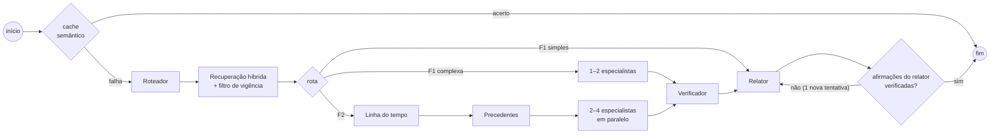

# Agentes do SAD-GD — especificação

Framework: LangGraph [ADR-003]. Modelos: [ADR-004]. Os **prompts de sistema versionados** ficam em
`app/application/agentes/prompts/<agente>.v<N>.md` (front-matter com metadados + texto do prompt) e os **schemas JSON** em
`app/application/agentes/schemas/`. Toda alteração de prompt gera nova versão (`v2`, `v3`…) e nova linha em `docs/AVALIACAO.md`.

Todos os prompts começam com o bloco comum `_regras_comuns.v1.md` (mesmo prefixo → aproveita *prompt caching* quando o provedor oferecer e garante regras anti-alucinação idênticas).

## 1. Catálogo

| Agente | Tipo | Escopo | Saída (schema) | Prompt |
|---|---|---|---|---|
| Roteador | orquestração | Classifica a pergunta (F1 simples, F1 complexa, F2), define buscas, filtros e agentes | `roteador.v1.json` | `roteador.v1.md` |
| Analista de Linha do Tempo | orquestração | Cronologia, fases e relações entre documentos (8 classes) | `linha_do_tempo.v1.json` | `analista_linha_do_tempo.v1.md` |
| Verificador de Fontes | orquestração | Confere se cada afirmação tem trecho de suporte; rejeita o resto | `verificador.v1.json` | `verificador_fontes.v1.md` |
| Relator / Sintetizador | orquestração | Consolida pareceres (consensos/divergências), redige a resposta final | `relator.v1.json` | `relator.v1.md` |
| Procurador do Estado | especialista | Legalidade, constitucionalidade, competência, riscos jurídicos ao ente | `parecer_especialista.v1.json` | `procurador_estado.v1.md` |
| Advogado | especialista | Interpretação contratual, direitos/obrigações, rescisão, litígio | idem | `advogado.v1.md` |
| Controlador-Geral do Estado | especialista | Conformidade, controle interno, improbidade, TCE/TCU/CGU | idem | `controlador_geral.v1.md` |
| Fiscal de Contrato | especialista | Execução, prazos, entregas, penalidades, aditivos (Lei 14.133/2021) | idem | `fiscal_contrato.v1.md` |
| Gestor Público | especialista | Viabilidade, impacto, interesse público, conveniência e oportunidade | idem | `gestor_publico.v1.md` |
| Analista Administrativo | especialista | Fluxo processual, instrução documental, requisitos formais e prazos | idem | `analista_administrativo.v1.md` |
| **Analista Orçamentário-Financeiro** (proposto) | especialista | Dotação, empenho, LRF, impacto financeiro, reequilíbrio | idem | `analista_orcamentario_financeiro.v1.md` |
| **Especialista em Licitações** (proposto) | especialista | Fase preparatória, modalidades, dispensa/inexigibilidade, ETP/TR, atas | idem | `especialista_licitacoes.v1.md` |

### Justificativa dos perfis propostos

- **Analista Orçamentário-Financeiro:** decisões de prorrogação, aditivo de valor e reequilíbrio dependem de dotação, empenho e limites da LRF — tema técnico distinto da "viabilidade" ampla do Gestor; sem esse perfil, o Gestor acumularia escopo e o roteamento perderia precisão.
- **Especialista em Licitações:** o Fiscal cobre a **execução**; perguntas sobre **contratação** (dispensa, inexigibilidade, adesão a ata, ETP/TR) exigem outro recorte da Lei 14.133/2021.
- **Não propostos:** "Auditor" (sobreposto ao Controlador-Geral) e "Anonimizador" (é um componente determinístico, não um agente com LLM).

## 2. Grafo de execução

O verificador roda **sobre os pareceres e sobre a resposta final** (no caso F1 simples, só sobre a final). Após uma nova tentativa sem sucesso, as afirmações sem suporte são removidas e a resposta é marcada com confiança reduzida.

## 3. Matriz de acionamento (critérios)

O roteador calcula uma pontuação por agente a partir de sinais da pergunta e dos metadados dos trechos recuperados. Regras: **F1 simples → nenhum especialista**; **F1 complexa → até 2**; **F2 → Gestor Público + até 3 de maior pontuação**. Nunca todos por padrão.

| Agente | Sinais na pergunta | Sinais nos trechos recuperados | Sempre em |
|---|---|---|---|
| Fiscal de Contrato | vigência, prazo, aditivo, prorrogação, penalidade, medição, entrega, fiscalização, reajuste | `tipo_documental ∈ {contrato, aditivo, apostilamento}` | — |
| Advogado | cláusula, obrigação, direito, rescisão, notificação, responsabilidade, litígio | cláusulas contratuais | — |
| Procurador do Estado | legalidade, constitucional, competência, nulidade, parecer jurídico, risco jurídico | normas de nível 1–2 | F2 com ato normativo novo |
| Controlador-Geral | conformidade, irregularidade, TCE, TCU, CGU, improbidade, auditoria, controle | acórdãos/recomendações de controle | — |
| Gestor Público | decidir, recomendar, viável, conveniência, oportunidade, prioridade | — | **F2** |
| Analista Administrativo | instrução, documentos necessários, fluxo, tramitação, prazo processual, checklist | despachos, ofícios | — |
| Analista Orçamentário-Financeiro | orçamento, dotação, empenho, LRF, custo, impacto financeiro, reequilíbrio | valores, notas de empenho | F2 com impacto de valor |
| Especialista em Licitações | licitação, pregão, dispensa, inexigibilidade, ETP, termo de referência, ata | editais, ETP/TR | — |
| Analista de Linha do Tempo | histórico, sequência, "o que mudou", último aditivo, revogada?, ainda vale? | ≥ 2 documentos do mesmo processo | **F2** com processo identificado |

## 4. Contrato de saída comum dos especialistas

Schema: `app/application/agentes/schemas/parecer_especialista.v1.json`. Elementos obrigatórios (prompt mestre §2):

| Campo | Conteúdo |
|---|---|
| `parecer` | Texto curto (≤ 1.200 caracteres) |
| `afirmacoes[]` | Cada afirmação com `tipo` (fato/inferência) e `citacoes` (ids de trechos `T…` fornecidos no contexto) |
| `fundamentacao_legal[]` | Norma, dispositivo, trecho, se está vigente |
| `riscos[]` | Descrição, probabilidade, impacto, mitigação |
| `alternativas[]` | Opções com prós e contras (F2) |
| `lacunas[]` | O que falta na base para concluir |
| `conflitos[]` | Divergências entre documentos, com os trechos |
| `confianca` | 0–1 |

Regra de ouro: **o agente só pode citar ids de trechos que recebeu**. O verificador rejeita qualquer id inexistente e checa sobreposição lexical entre a afirmação e o trecho antes de pedir julgamento ao LLM.

## 5. Métricas por agente

| Agente | Métrica | Meta |
|---|---|---|
| Roteador | Acurácia da rota; precisão/recall dos agentes acionados | ≥ 0,90 / ≥ 0,80 |
| Linha do Tempo | F1-macro das 8 relações; acurácia da ordenação | ≥ 0,85 / ≥ 0,95 |
| Verificador | Precisão e recall na detecção de afirmação sem suporte (casos plantados) | ≥ 0,90 |
| Especialistas | Validade do JSON; citações corretas; faithfulness | 100% / ≥ 0,95 / ≥ 0,90 |
| Relator | Faithfulness; presença dos elementos F2; consensos/divergências corretos | ≥ 0,90 / 100% |
