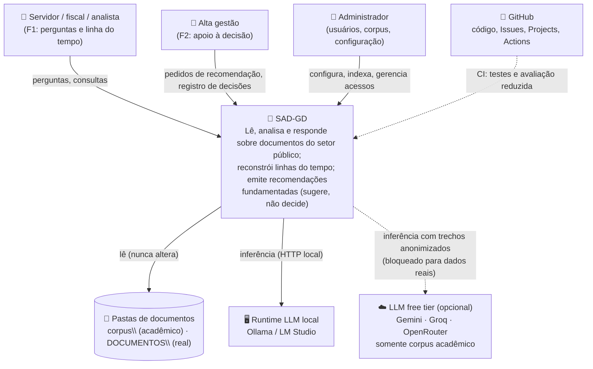
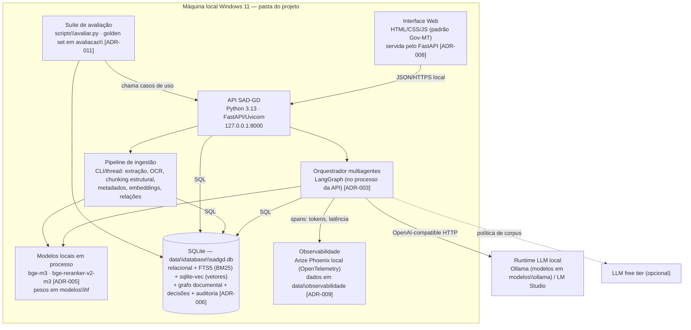
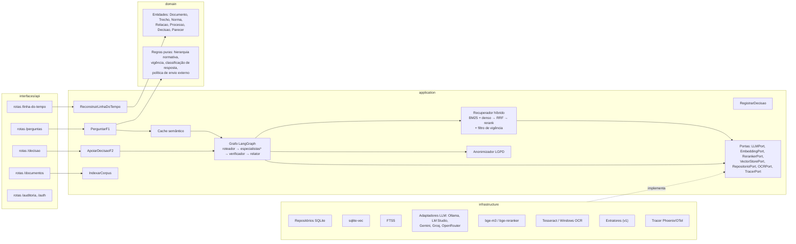
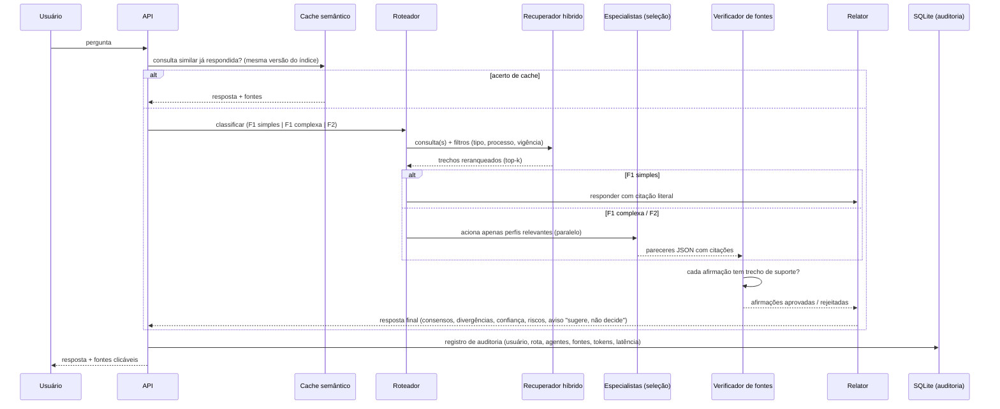
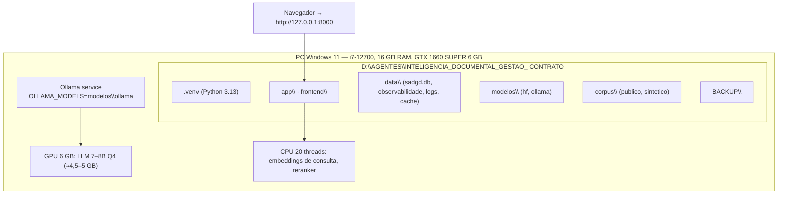

# Arquitetura C4 — SAD-GD

Modelo C4 (Simon Brown): Contexto → Contêineres → Componentes, mais a visão de implantação local.
Decisões que justificam cada elemento estão em `docs/adr/` (referenciadas entre colchetes).

---

## Nível 1 — Contexto do sistema

Fronteira de confiança: **tudo à esquerda de "LLM free tier" roda na máquina local** [ADR-001]. O envio externo é bloqueado por política quando a base ativa contém dados reais [ADR-002, ADR-004].

---

## Nível 2 — Contêineres

| Contêiner | Tecnologia | Responsabilidade |
|---|---|---|
| Interface Web | HTML/CSS/JS puro, tokens Gov-MT | Chat, fontes clicáveis, pareceres por agente, linha do tempo, upload, administração |
| API | FastAPI | Autenticação/perfis, endpoints F1/F2, documentos, linha do tempo, decisões, auditoria |
| Orquestrador | LangGraph | Roteamento, execução seletiva de especialistas, verificação, síntese |
| Ingestão | Python (extratores v1 + PyMuPDF + Tesseract) | Leitura incremental, chunking estrutural, metadados, embeddings, relações |
| Modelos locais | sentence-transformers / FlagEmbedding | Embeddings densos e reranking |
| SQLite | SQLite 3 + FTS5 + sqlite-vec | Fonte única de dados persistidos |
| Observabilidade | Arize Phoenix (pip, sem Docker) | Traces por consulta, tokens, latência, custo |
| Avaliação | Python + RAGAS + métricas próprias | Métricas de recuperação, classificação, geração e operação |

---

## Nível 3 — Componentes da API e do orquestrador

Organização em Clean Architecture [ADR-013]: dependências apontam para dentro (`interfaces → application → domain`; `infrastructure` implementa portas de `application`).

### Fluxo de uma consulta (sequência)

---

## Visão de implantação (local)

Orçamento de memória: LLM na GPU (≈5 GB VRAM); bge-m3 na GPU apenas durante indexação em lote (LLM descarregado) e na CPU durante consultas; reranker na CPU com top-20 e truncamento em 512 tokens (latência a medir na Fase 5; plano B em ADR-005).
