# Modelo de dados e grafo documental — SAD-GD

Banco único SQLite `data\database\sadgd.db` [ADR-006]. Criado por migrações versionadas (`app\infrastructure\sqlite\migracoes\NNN_*.sql`) na Fase 3. Datas em ISO-8601; booleanos como INTEGER 0/1.

## 1. Diagrama entidade-relacionamento

```mermaid
erDiagram
    DOCUMENTO ||--o{ TRECHO : "dividido em"
    TRECHO ||--|| TRECHO_VETOR : "embedding (vec0)"
    DOCUMENTO ||--o| NORMA : "é (se normativo)"
    DOCUMENTO ||--o{ DOCUMENTO_PROCESSO : participa
    PROCESSO ||--o{ DOCUMENTO_PROCESSO : agrupa
    DOCUMENTO ||--o{ RELACAO : "origem"
    DOCUMENTO ||--o{ RELACAO : "destino"
    TRECHO ||--o{ RELACAO : "evidência"
    DOCUMENTO ||--o{ CONTRATO : "fonte de"
    CONTRATO ||--o{ CONTRATO_ITEM : contém
    DECISAO ||--o{ DECISAO_FONTE : fundamenta
    DOCUMENTO ||--o{ DECISAO_FONTE : citado
    PROCESSO ||--o{ DECISAO : "contexto"
    USUARIO ||--o{ CONSULTA : faz
    CONSULTA ||--o{ PARECER : gera
    CONSULTA ||--o{ SPAN : "trace"
    CONSULTA ||--o{ CONSULTA_FONTE : cita
    USUARIO ||--o{ AUDITORIA : "ações"

    DOCUMENTO {
        int id PK
        text caminho UK
        text hash
        text extensao
        text status "COM_TEXTO|COM_OCR|SEM_TEXTO|CORROMPIDO|..."
        text corpus_origem "publico|sintetico|real"
        text tipo_documental "contrato|aditivo|apostilamento|lei|decreto|in|orientacao|parecer|oficio|nota_tecnica|..."
        text numero
        text orgao
        text data_documento
        text vigencia_inicio
        text vigencia_fim
        text titulo
        int paginas
        text indexado_em
    }
    TRECHO {
        int id PK
        int documento_id FK
        int ordem
        text texto
        int pagina
        text dispositivo "art. 107, § 2º, III / Cláusula Quinta, 5.1"
        text tipo_dispositivo "artigo|paragrafo|inciso|alinea|clausula|subclausula|secao|livre"
        text caminho "Título II > Cap. I > Art. 107"
        int inicio
        int fim
        int tokens
    }
    TRECHO_VETOR {
        int trecho_id PK
        blob embedding "float[1024] (sqlite-vec)"
    }
    NORMA {
        int documento_id PK
        text especie "CF|LC|LEI|DECRETO|IN|PORTARIA|ORIENTACAO|PARECER"
        int nivel "1=CF ... 5=Orientação"
        text esfera "federal|estadual|municipal"
        text numero
        int ano
        text situacao "vigente|revogada|parcialmente_revogada"
        int revogada_por FK
    }
    PROCESSO {
        int id PK
        text tipo "processo|contrato|tema"
        text chave "nº processo / nº contrato / tema normalizado"
        text titulo
    }
    DOCUMENTO_PROCESSO {
        int documento_id FK
        int processo_id FK
        text papel "originario|aditivo|parecer|..."
        real confianca
    }
    RELACAO {
        int id PK
        int origem_id FK
        int destino_id FK
        text tipo
        real confianca
        text metodo "regra|llm|manual"
        int evidencia_trecho_id FK
        text justificativa
        int validada "0|1 (revisão humana)"
    }
    CONTRATO {
        int id PK
        int documento_id FK
        text numero
        text processo
        text contratada
        text cnpj
        text objeto
        text valor
        text assinatura
        text inicio
        text fim
    }
    CONTRATO_ITEM {
        int id PK
        int contrato_id FK
        text descricao
        text quantidade
        text valor_unitario
        text valor_total
    }
    DECISAO {
        int id PK
        int processo_id FK
        text titulo
        text contexto
        text decisao
        text fundamentos
        text decisor_perfil
        text data
        text resultado
        text avaliacao_resultado "positivo|negativo|neutro|pendente"
        blob embedding
    }
    DECISAO_FONTE {
        int decisao_id FK
        int documento_id FK
        int trecho_id FK
    }
    USUARIO {
        int id PK
        text login UK
        text perfil "administrador|gestor|consulta"
    }
    CONSULTA {
        int id PK
        int usuario_id FK
        text pergunta_hash "texto integral não é guardado na auditoria"
        text rota "F1_simples|F1_complexa|F2"
        text agentes
        text classificacao "fato|inferencia|conflito|ausencia"
        real confianca
        int tokens_entrada
        int tokens_saida
        int latencia_ms
        int cache_hit
        text versao_indice
        text criado_em
    }
    PARECER {
        int id PK
        int consulta_id FK
        text agente
        text versao_prompt
        text saida_json
        int valido
    }
    SPAN {
        int id PK
        int consulta_id FK
        text no
        text modelo
        int tokens_entrada
        int tokens_saida
        int latencia_ms
    }
    CONSULTA_FONTE {
        int consulta_id FK
        int trecho_id FK
        int aprovada_verificador
    }
    AUDITORIA {
        int id PK
        int usuario_id FK
        text acao
        text alvo
        text ip
        text criado_em
    }
```



Tabelas virtuais: `trechos_fts` (FTS5 sobre `TRECHO.texto` + título, `content='trechos'` para remoção em cascata correta), `trechos_vec` (`vec0`, 1024 dims). Tabelas auxiliares: `cache_semantico` (embedding da pergunta normalizada, resposta JSON, `versao_indice`), `checkpoints` do LangGraph, `configuracoes`, `sessoes`, `indexacoes`, e as tabelas de checklist da v1.

> Lição da v1 (HABILIDADES.md): FTS5 sem *external content* não é limpo por `ON DELETE CASCADE`. No novo esquema o FTS usa `content=` + gatilhos de sincronização.

## 2. Grafo documental

**Nós:** `DOCUMENTO` (com `NORMA` quando normativo) e `PROCESSO` (agrupador).
**Arestas:** `RELACAO` (documento → documento) e `DOCUMENTO_PROCESSO` (pertinência).

### Tipos de relação

| Tipo | Classe avaliada (RF-12) | Definição operacional | Marcadores típicos (regras) |
|---|---|---|---|
| `continuacao` | ✅ | B dá seguimento a A no mesmo processo sem alterá-lo | "em continuidade", despacho, encaminhamento |
| `aditivo` | ✅ | B é termo aditivo de contrato A | "Termo Aditivo nº", "aditar" |
| `alteracao` | ✅ | B modifica parte do conteúdo de A (redação, valor, prazo) sem extingui-lo | "altera a redação", "passa a vigorar", apostilamento de valor |
| `revogacao` | ✅ | B retira a vigência de A (total ou parcial) | "revoga-se", "fica revogado", "revogam-se as disposições" |
| `substituicao` | ✅ | B toma o lugar de A integralmente (nova versão, nova norma sobre o mesmo objeto) | "substitui", "em substituição a" |
| `ruptura` | ✅ | B interrompe/extingue a execução de A (rescisão, suspensão, anulação) | "rescisão", "suspensão", "anulação", "paralisação" |
| `contradicao` | ✅ | B e A afirmam fatos incompatíveis sem que um declare alterar o outro | divergência de valor/data/prazo detectada por comparação de campos |
| `retomada` | ✅ | B reinicia algo antes interrompido por uma `ruptura` | "retomada", "reativação", "ordem de reinício" |
| `regulamenta` | auxiliar | B regulamenta A (decreto → lei) | "regulamenta a Lei nº" |
| `fundamenta` | auxiliar | B cita A como base legal | "nos termos do art.", "com fundamento" |

Toda aresta guarda **confiança**, **método** (regra/LLM/manual) e **trecho de evidência** — a linha do tempo nunca mostra relação sem fonte.

### Regras de domínio sobre o grafo

1. **Hierarquia:** `nivel` CF(1) > Lei/LC(2) > Decreto(3) > IN/Portaria(4) > Orientação/Parecer(5). Em conflito entre normas vigentes, a de nível superior prevalece; entre mesmo nível, a posterior (registrado como **inferência**, com fontes).
2. **Vigência:** norma com `situacao=revogada` (ou dispositivo revogado) é excluída do conjunto "fundamentação atual" pelo recuperador, mas aparece na linha do tempo como histórico.
3. **Ciclos** de revogação/substituição são sinalizados como inconsistência para revisão humana.
4. **Linha do tempo de um processo:** ordenação por `data_documento` (desempate por ordinal/número), com as fases delimitadas por arestas `ruptura`/`retomada`.

Consulta típica (antecessores de um documento até a origem):

```sql
WITH RECURSIVE cadeia(id, nivel) AS (
  SELECT :documento_id, 0
  UNION ALL
  SELECT r.origem_id, c.nivel + 1 FROM relacoes r JOIN cadeia c ON r.destino_id = c.id
  WHERE r.tipo IN ('aditivo','alteracao','substituicao','continuacao','retomada') AND c.nivel < 50
)
SELECT d.*, c.nivel FROM cadeia c JOIN documentos d ON d.id = c.id ORDER BY d.data_documento;
```

## 3. LGPD no modelo

- `CONSULTA` guarda `pergunta_hash`, não o texto (o texto fica só no trace local opcional, com retenção configurável).
- Dados pessoais detectados nos trechos (CPF, e-mail, telefone, nomes de PF) são mascarados pelo anonimizador **antes** de qualquer envio externo e em exportações marcadas como "anonimizadas".
- `corpus_origem='real'` bloqueia provedores remotos (ADR-004).
