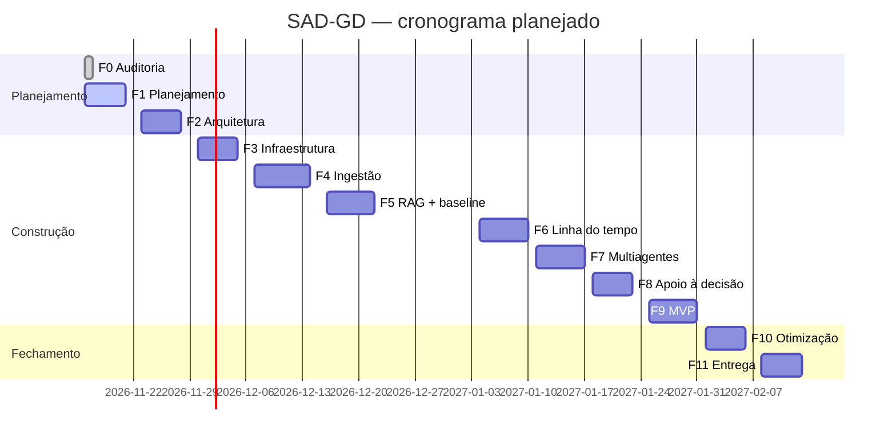

# Cronograma — SAD-GD

Cada fase = 1 sprint Scrum (planejamento → execução → revisão/aprovação → retrospectiva).
Datas planejadas a partir de 2026-11-17, sprints de 1 semana, com folga de 1 semana antes da entrega.

> ⚠️ **[VERIFICAR]** Data-limite de entrega acadêmica não informada. Assumida **2027-02-12**. Ajustar quando o responsável confirmar; o caminho crítico abaixo indica onde comprimir.

| Sprint | Fase | Início | Fim | Entregável-chave | Dependências |
|---|---|---|---|---|---|
| S0 | 0 — Auditoria | 2026-11-16 | 2026-11-16 | FASE_00 ✅ | — |
| S1 | 1 — Iniciação e planejamento | 2026-11-16 | 2026-11-20 | TAP, requisitos, EAP, riscos, backlog | S0 |
| S2 | 2 — Arquitetura | 2026-11-23 | 2026-11-27 | C4, ADRs, modelo de dados, specs de agentes | S1 |
| S3 | 3 — Infraestrutura local | 2026-11-30 | 2026-12-04 | Repo reestruturado, CI verde, observabilidade | S2 |
| S4 | 4 — Ingestão e base | 2026-12-07 | 2026-12-15 | Corpus, chunking estrutural, índice híbrido | S3 |
| S5 | 5 — RAG + golden set + baseline | 2026-12-16 | 2026-12-23 | Golden set, AVALIACAO v1×v2 | S4 |
| — | Recesso / folga | 2026-12-24 | 2027-01-03 | — | — |
| S6 | 6 — Linha do tempo e relações | 2027-01-04 | 2027-01-09 | Classificador + matriz de confusão | S4, S5 |
| S7 | 7 — Multiagentes | 2027-01-11 | 2027-01-16 | Roteador, especialistas, verificador, relator | S5, S6 |
| S8 | 8 — Apoio à decisão (F2) | 2027-01-18 | 2027-01-22 | Memória de decisões, recomendação F2 | S7 |
| S9 | 9 — MVP completo | 2027-01-25 | 2027-01-30 | Interface completa, autenticação | S7, S8 |
| S10 | 10 — Otimização e avaliação final | 2027-02-01 | 2027-02-05 | Métricas finais × metas | S9 |
| S11 | 11 — Entrega acadêmica | 2027-02-08 | 2027-02-12 | Relatório, apresentação, vídeo | S10 |

## Caminho crítico

S1 → S2 → S3 → S4 → S5 → S6 → S7 → S8 → S9 → S10 → S11 (sequencial por aprovação de fase).
Maior risco de prazo: **S4/S5** (corpus e golden set dependem de curadoria manual) e **S7** (qualidade do LLM local).

## Paralelismos possíveis

- Curadoria do corpus público (4.0.1) e redação do golden set (5.0.3) podem começar durante S3, por serem documentais.
- Frontend (9.0.x) pode avançar em paralelo a S8 após a API de S7 estabilizar.

## Gráfico (Gantt)

